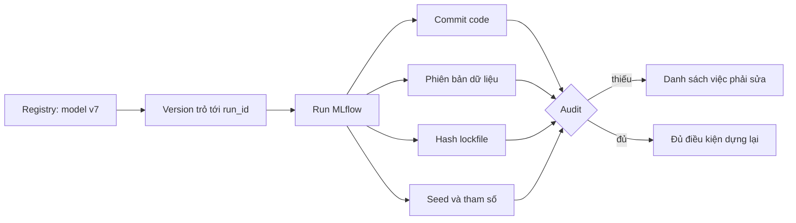
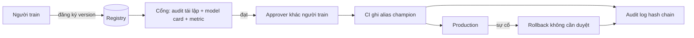

# Nền tảng ML, governance và chi phí

Đến module 11 bạn đã có một model chạy được. Module này hỏi những câu mà quản lý, kiểm toán và bộ phận tài chính sẽ hỏi: model này sinh ra từ đâu và dựng lại được không, ai cho phép nó lên production, nó tốn bao nhiêu tiền kể cả lúc không ai gọi, và khi nào nên dùng dịch vụ cloud thay vì tự dựng. Phần lớn chạy trên máy bạn (MLflow cục bộ, YAML, kiểm tra tĩnh); cloud thật chỉ là lab **tuỳ chọn**, và không bài chấm nào cần tài khoản, khoá hay mạng cloud.

## 1. Reproducibility audit: từ một model truy ngược mọi đầu vào

"Tái lập được" nghĩa là: cho một model trong registry, người khác (hay chính bạn sáu tháng sau) dựng lại được model đó, hoặc ít nhất giải thích được nó đến từ đâu. Khác với "log nhiều", đây là một **câu hỏi kiểm chứng được**: bốn thứ tối thiểu mà mỗi run production phải có.

| Mục | Ghi ở đâu | Chỉ coi là đạt khi |
| --- | --- | --- |
| Commit code | tag `git_commit`, `git_dirty` | đủ 40 ký tự hex và cây thư mục sạch |
| Phiên bản dữ liệu | tag `data_version` | là định danh nội dung (hash DVC), không phải `latest` |
| Hash lockfile | tag `lockfile_sha256` | 64 ký tự hex của tệp mô tả thứ chạy |
| Seed | param `seed` | một số nguyên |

Ba quyết định thiết kế đáng nhớ (bài 01 cơ bản):

- **Audit trả "thiếu gì", không trả "ok/không".** Người nhận cần hành động cụ thể.
- **Kiểm hình dạng, không chỉ sự có mặt.** `data_version = latest` có mặt nhưng vô nghĩa vì đổi theo thời gian; commit 7 ký tự có thể va chạm; cây bẩn biến hash thành lời nói dối.
- **Truy ngược theo version trong registry**, không theo "run mới nhất" của experiment: model trỏ về đúng một `run_id`.

Audit hình dạng chỉ là bước đầu. Một danh sách tag đẹp là **khẳng định**, và khẳng định cần kiểm chứng: mức cao nhất của một reproducibility audit là *dựng lại thật rồi so dự đoán với bản gốc*, định kỳ, trên các model production. Khi hai kết quả lệch dù mọi thứ trong checklist trùng khớp, hãy coi đó là lỗi của checklist chứ không phải của người dựng lại (bài sự cố trung cấp 02).

## 2. Model governance: approval, audit log, model card, quyền, tách quyền

Governance là câu trả lời cho "ai được làm gì với model, dựa trên bằng chứng nào, và làm sao chứng minh sau này". Năm mảnh ghép:

| Mảnh ghép | Câu hỏi nó trả lời | Cơ chế thực thi tốt | Cơ chế yếu hay gặp |
| --- | --- | --- | --- |
| Approval | ai cho phép lên production | CI từ chối nếu approver trùng người train; hai người ở tầng rủi ro cao | "nhớ hỏi sếp" trong wiki |
| Audit log | ai, lúc nào, alias cũ sang mới, vì sao | chỉ ghi thêm, hash chain, neo hash ra hệ thống khác | bảng trong database mà admin sửa được |
| Model card | model làm gì, không làm gì, đánh giá trên ai | sinh từ run, là điều kiện của cổng promote | tài liệu viết một lần rồi bỏ |
| Quyền registry | đội nào ghi alias của model nào | proxy hay IdP đứng trước registry, quyền theo prefix | mọi người dùng chung một tài khoản |
| Tách quyền | người train có tự duyệt được không | vai trò approver khác vai trò trainer | cùng một người bấm cả hai |

**Audit log append-only (bài 02 cơ bản).** Mỗi dòng chứa hash của dòng trước, nên sửa một dòng làm hỏng mọi dòng sau; kẻ sửa phải tính lại cả phần đuôi. Hai giới hạn: cắt các dòng cuối không để lại dấu trong chuỗi, nên cần **anchor** (hash đầu log lưu ở nơi người được audit không ghi được); và log chỉ ghi lại thao tác đi qua ứng dụng, không ngăn người có quyền ghi thẳng vào registry. Tách quyền thật nằm ở việc khoá quyền ghi, log chỉ làm cho vi phạm lộ ra.

**Governance theo tầng rủi ro (bài 01 nâng cao).** Cùng một quy trình cho mọi đội là sai: `credit-risk` cần hai người duyệt và lưu giữ nhiều năm; `research` cần gần như không gì. Kiểm soát chỉ đáng giá khi rẻ hơn hậu quả nó ngăn, và mỗi kiểm soát phải nói ai thực thi bằng cơ chế nào. Nhắc về yêu cầu pháp lý: một số lĩnh vực (tín dụng, y tế) có quy định riêng về giải thích và lưu vết quyết định tự động; đây là lý do cần hỏi bộ phận tuân thủ sớm, không phải thứ suy ra từ công cụ.

## 3. Chi phí ML: train, serve, nhàn rỗi và ước tính

Hoá đơn ML có hai nhịp khác nhau.

| | Train | Serve |
| --- | --- | --- |
| Trả theo | số lần chạy × giờ × giá máy | giờ máy **bật**, bất kể có request |
| Chịu ngắt được không | có, nếu có checkpoint (spot rẻ hơn nhiều) | thường không |
| Cái hay quên | GPU để lại sau khi chạy xong | máy nhàn rỗi, NAT, log, egress |
| Đòn bẩy | spot, giảm số lần chạy, dừng sớm | co về 0, nhỏ máy, cam kết dài hạn |

Công thức ước tính cho một kịch bản (bài 03 cơ bản):

$$\text{serve} = p \times \text{replicas} \times h_{\text{tính tiền}} \times m_{\text{cam kết}}, \qquad \text{idle} = \text{serve} \times (1 - u)$$

với $$p$$ là giá giờ, $$u$$ là tỉ lệ thời gian máy thật sự bận, $$h$$ là 730 giờ mỗi tháng khi máy luôn bật. Điều ngược trực giác: một đội mới lo giá GPU để train, nhưng hoá đơn thường nằm ở vài máy CPU chạy 730 giờ mỗi tháng với mức sử dụng 15%. `scale_to_zero` bỏ gần hết phần nhàn rỗi nhưng đổi bằng **khởi động nguội** (request đầu tiên chờ tải model); cam kết dài hạn giảm giá giờ nhưng vẫn trả cho giờ rảnh và khoá bạn vào một cỡ máy. Chọn theo yêu cầu độ trễ, không theo giá.

Ước tính chỉ là khuôn: số thật lấy từ bảng giá hiện hành của nhà cung cấp; nhớ cộng các khoản hay bị bỏ (NAT, load balancer, log, lưu trữ artifact, egress, chênh lệch theo vùng) và đặt budget alarm cho kết quả của bạn.

## 4. Cloud ML services: SageMaker, Vertex AI, Azure ML

Ba dịch vụ cùng bán một ý: "bạn lo model, chúng tôi lo hạ tầng". Chúng khác nhau ở cách đóng gói, và đều có **tên riêng cho cùng khái niệm** mà bạn đã học ở module 04, 05 và 07.

| Khái niệm | AWS SageMaker | Google Vertex AI | Azure Machine Learning |
| --- | --- | --- | --- |
| Registry | Model Registry (model group, model package, trạng thái duyệt) | Model Registry (version, alias) | Model registry trong workspace (version, tag) |
| Endpoint online | real-time endpoint; có serverless, async, batch transform | Endpoint (deploy model lên node) | managed online endpoint (deployment, chia lưu lượng) |
| Pipeline | SageMaker Pipelines | Vertex AI Pipelines (KFP) | Azure ML pipelines (component, job) |
| Tracking | managed MLflow, Experiments | Vertex AI Experiments (tích hợp MLflow) | MLflow tích hợp sẵn trong workspace |
| Cách tính tiền chính | instance-giờ của endpoint, giờ train, serverless theo request | node-giờ của endpoint, giờ train | giờ VM của deployment, giờ cluster train |
| Dễ quên nhất | endpoint chạy mãi, notebook, NAT | endpoint với replica tối thiểu | deployment, cluster không về 0 |

Bảng chỉ để định hướng; tính năng và giá đổi theo quý, nên luôn đọc tài liệu và bảng giá hiện hành trước khi quyết định.

Khi nào dùng dịch vụ quản lý, khi nào tự dựng? Hãy nghĩ ở dạng **đánh đổi có số** (bài 02 nâng cao), không phải tôn giáo:

| Câu hỏi | Nghiêng về dịch vụ cloud | Nghiêng về tự dựng |
| --- | --- | --- |
| Ai vận hành | đội nhỏ, kỹ sư nền tảng bán thời gian | có đội nền tảng chuyên trách |
| Dữ liệu ở đâu | đã nằm ngay trên cloud đó | nhiều nơi, hoặc on-premise |
| Tốc độ cần | ra production nhanh, ít đường vòng | tuỳ biến sâu (serving, scheduling) |
| Chi phí tăng theo thời gian | chấp nhận trả theo mức dùng | điểm hoà vốn đã qua (tính bằng số) |
| Lo ngại lock-in | pipeline giữ ở định dạng mở | muốn rời được, đã có kỹ năng |

Điều có giá trị là giữ **đường rút lui rẻ**: artifact theo chuẩn mở (MLflow), serving đóng container chuẩn, pipeline mô tả khai báo; khi đó chọn dịch vụ cloud hôm nay không phải là quyết định một chiều.

## 5. Lab cloud tuỳ chọn: free tier, budget alarm, dọn dẹp, chi phí ẩn

Phần này là **hướng dẫn**, không có test nào cần tài khoản. Nếu bạn làm lab thật, hãy theo thứ tự dưới đây; thứ tự quan trọng hơn dịch vụ bạn chọn.

1. **Chọn một dịch vụ, một vùng, một dự án riêng.** Dùng tài khoản/dự án chỉ cho lab để dọn bằng một thao tác và để hoá đơn không lẫn.
2. **Đọc free tier hiện hành của nhà cung cấp.** Thường có hạn mức theo tháng hoặc 12 tháng đầu và *không* gồm mọi loại máy (endpoint GPU thường không miễn phí). Ghi lại ngày hết hạn ưu đãi.
3. **Đặt budget alarm trước khi tạo bất cứ thứ gì.** Ngưỡng nhỏ (10 đến 20 USD) cộng email. Nhớ: budget alarm **chỉ báo**, không dừng chi tiêu, và dữ liệu chi phí trễ hàng giờ tới ngày.
4. **Gắn tag `lab=<id>` cho mọi thứ**, để bước dọn chỉ động tới đồ của mình (bài 03 trung cấp).
5. **Dọn trước khi ngủ.** In kế hoạch dọn bằng dry-run trước, rồi mới chạy thật; sau đó kiểm trong console xem có gì còn sót.

Lệnh dọn (đã có trong bài 03 trung cấp, ở dạng sinh và kiểm tĩnh; đối chiếu với tài liệu của nhà cung cấp trước khi chạy thật):

| Dịch vụ | Việc phải dọn | Thứ tự |
| --- | --- | --- |
| SageMaker | endpoint, endpoint config, model, notebook (stop rồi delete), bucket, NAT | endpoint trước config trước model |
| Vertex AI | endpoint (gỡ model khỏi endpoint nếu dịch vụ yêu cầu), model, bucket | endpoint trước model |
| Azure ML | online endpoint, hoặc xoá cả resource group của lab | resource group cuối cùng |

Chi phí ẩn hay gặp, ngoài thứ bạn nghĩ đến: NAT gateway (tính theo giờ và theo GB), endpoint quên tắt, notebook đang chạy, snapshot đĩa, log và bucket giữ lại, egress, và dịch vụ tạo ở vùng khác với vùng bạn đang nhìn trong console. Cài CLI của nhà cung cấp theo tài liệu chính thức của họ, kiểm checksum nếu tải tệp, và không bao giờ chạy lệnh cài kiểu pipe vào shell với quyền root.

## 6. Ôn nhanh từ track Data Engineer: IaC và data engineering cho ML

Phần này chỉ ôn, vì đã học ở track Data Engineer. Đọc lại khi cần; ở đây chỉ nói điều **đặc thù cho ML**.

### IaC cho ML ở mức đọc hiểu

Terraform dạy ở [module DE 08: DevOps cho dữ liệu](../../../data-engineer/modules/08-devops-for-data/README.md). Với ML bạn chủ yếu **đọc** IaC của đội nền tảng và review: resource nào tính tiền khi rảnh (endpoint, notebook, NAT), tag `owner` và `ttl` có không, lệnh xem trước `terraform plan -destroy`, và vì sao `destroy` chỉ động tới thứ nằm trong state. Bài 01 trung cấp luyện đúng việc đó trên một tệp Terraform mẫu, không chạy `terraform`.

### Data engineering cho ML

Nhiều lỗi ML thật nằm ở dữ liệu đưa vào. Các khối bạn dùng lại, theo module gốc:

| Khối | Dùng khi | Module gốc |
| --- | --- | --- |
| Batch (idempotent, backfill, retry) | tạo bảng training, feature theo lô | [DE 05: pipeline batch](../../../data-engineer/modules/05-batch-pipelines/README.md) |
| Spark | dữ liệu lớn hơn một máy, feature engineering phân tán | [DE 06: Spark và big data](../../../data-engineer/modules/06-spark-big-data/README.md) |
| Kafka, Flink | feature thời gian thực, sự kiện cho model online | [DE 07: streaming và Kafka](../../../data-engineer/modules/07-streaming-kafka/README.md) |
| Governance dữ liệu | quyền truy cập, lineage, PII | [DE 10: bảo mật và governance](../../../data-engineer/modules/10-security-governance/README.md) |

Điều ML thêm vào: bảng training phải **tái lập theo thời điểm** (point-in-time, không rò rỉ tương lai), và phiên bản dữ liệu phải đi cùng run như ở mục 1.

## 7. Tài liệu tham khảo

- MLflow, Model Registry và tracking: https://mlflow.org/docs/latest/ml/model-registry/
- Mitchell et al., *Model Cards for Model Reporting*, FAT* 2019.
- Google, *Rules of Machine Learning*: https://developers.google.com/machine-learning/guides/rules-of-ml
- AWS SageMaker, tài liệu (Model Registry, Endpoints, Pipelines, giá): https://docs.aws.amazon.com/sagemaker/
- Google Vertex AI, tài liệu (Model Registry, Endpoints, Pipelines): https://cloud.google.com/vertex-ai/docs
- Azure Machine Learning, tài liệu (models, online endpoints, pipelines): https://learn.microsoft.com/azure/machine-learning/
- AWS Budgets và Cost Anomaly Detection: https://docs.aws.amazon.com/cost-management/
- Terraform, tài liệu (`plan -destroy`, `state list`): https://developer.hashicorp.com/terraform/docs
- Sculley et al., *Hidden Technical Debt in Machine Learning Systems*, NeurIPS 2015.
- Module DE 08 (IaC), 05, 06, 07, 10: `tracks/data-engineer/modules/`
