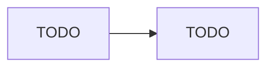

# Governance cho ba đội ML

## 1. Phân tầng rủi ro

TODO: bối cảnh, giả định, và vì sao mỗi đội ở tầng đó (không dưới 300 ký tự văn xuôi).

| Đội | Tầng | Lý do | Hậu quả khi sai |
| --- | --- | --- | --- |
| credit-risk | TODO | TODO | TODO |
| recsys | TODO | TODO | TODO |
| research | TODO | TODO | TODO |

## 2. Ma trận kiểm soát

| Kiểm soát | Cao | Trung bình | Thấp |
| --- | --- | --- | --- |
| TODO | TODO | TODO | TODO |

## 3. Tách quyền

- TODO

## 4. Audit và lưu giữ

TODO

## 5. Luồng duyệt

## 6. Chi phí và rủi ro

- TODO
