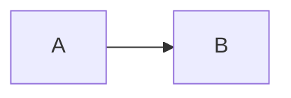

# Governance

## 1. Phân tầng rủi ro

Ba đội.

| Đội | Tầng | Lý do | Hậu quả khi sai |
| --- | --- | --- | --- |
| credit-risk | thấp | ít | ít |
| recsys | cao | nhiều | nhiều |
| research | cao | nhiều | nhiều |

## 2. Ma trận kiểm soát

| Kiểm soát | Cao | Trung bình | Thấp |
| --- | --- | --- | --- |
| Duyệt | Một người | Một người | Một người |
| Audit | Có | Có | Có |

## 3. Tách quyền

- Mọi người được duyệt.

## 4. Audit và lưu giữ

Có log, giữ 1 năm.

## 5. Luồng duyệt

## 6. Chi phí và rủi ro

- Không có rủi ro.
TODO
