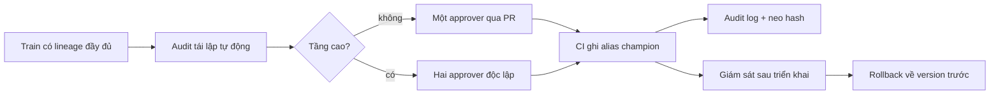

# Governance cho ba đội ML

## 1. Phân tầng rủi ro

Công ty có 25 người ML, hai kỹ sư nền tảng, một registry và một cụm Kubernetes dùng chung. Governance theo tầng rủi ro vì ba đội có hậu quả sai rất khác nhau, và một quy trình duy nhất hoặc làm chậm đội nghiên cứu hoặc bỏ hở đội tín dụng. Tầng đặt theo hậu quả khi sai và thanh tra, không theo kích thước đội: `credit-risk` chịu thanh tra và phải tái lập quyết định 5 năm nên ở tầng cao; `recsys` mất doanh thu nhưng sửa được trong ngày; `research` chưa chạm khách hàng. Giả định: các đội dùng chung hạ tầng nhưng tách quyền theo prefix tên model.

| Đội | Tầng | Lý do | Hậu quả khi sai |
| --- | --- | --- | --- |
| credit-risk | cao | Quyết định cho vay tự động, chịu thanh tra, phải tái lập 5 năm | Tổn thất tiền, phạt pháp lý, mất giấy phép |
| recsys | trung bình | Ảnh hưởng doanh thu trang chủ, không bị quản lý trực tiếp | Mất doanh thu trong vài giờ, rollback trong ngày |
| research | thấp | Notebook và thử nghiệm, không phục vụ khách | Mất thời gian thử nghiệm, không tác động khách hàng |

## 2. Ma trận kiểm soát

| Kiểm soát | Cao | Trung bình | Thấp |
| --- | --- | --- | --- |
| Duyệt lên production | Hai người duyệt độc lập: một chủ model, một đại diện rủi ro; ghi lý do | Một người duyệt (tech lead) qua pull request | Không có production; tự đăng ký staging |
| Audit tái lập trước khi promote | Bắt buộc: commit, data version, lockfile ghim, seed; chặn tự động | Bắt buộc, cảnh báo nếu thiếu lockfile ghim | Khuyến nghị, không chặn |
| Model card | Đầy đủ: dữ liệu, giới hạn, đánh giá công bằng, người ký | Bản rút gọn: dữ liệu, metric, giới hạn | Không bắt buộc |
| Quyền ghi alias champion | Chỉ vai trò approver qua CI, không ai ghi tay | Tech lead qua CI | Chủ model |
| Cửa sổ thay đổi | Chỉ giờ hành chính, có người trực rollback | Mọi giờ trừ cao điểm bán hàng | Không giới hạn |
| Giám sát sau triển khai | Drift, chất lượng theo nhãn, hằng ngày, báo cáo hằng tuần | Drift và proxy chất lượng, cảnh báo | Không |
| Giới hạn chi phí | Budget riêng, cảnh báo 80%, duyệt khi vượt | Budget chung của đội, cảnh báo 80% | Trần cứng, tự dọn quá 14 ngày |

## 3. Tách quyền

- Người train không được tự duyệt model của mình lên production: cột approver trong pipeline phải khác `train_user` ở tầng cao và trung bình; CI từ chối nếu trùng.
- Đội này không ghi được alias của đội khác: quyền registry cấp theo prefix tên model, và alias production chỉ ghi bởi tài khoản dịch vụ của CI, không phải người.
- Người vận hành nền tảng quản trị hạ tầng nhưng không duyệt nội dung model; duyệt rủi ro thuộc vai trò approver của từng đội.
- Truy cập artifact và dữ liệu của `credit-risk` chỉ cho đội này và approver rủi ro; các đội khác đọc metadata, không đọc artifact.
- Quyền break-glass (ghi tay khi sự cố) tồn tại, có hạn giờ, và tự động tạo một dòng audit log có lý do bắt buộc.

## 4. Audit và lưu giữ

Mọi thao tác trên registry (đổi alias, xoá version, đổi quyền) ghi vào audit log chỉ ghi thêm: ai, lúc nào, alias cũ sang mới, lý do. Mỗi dòng nối với dòng trước bằng hash để sửa lén bị phát hiện; hash đầu log được neo (anchor) ra hệ thống người train không ghi được, mỗi ngày. Retention: tầng cao giữ run, artifact, model card và audit log 5 năm (đáp ứng thanh tra), tầng trung bình 2 năm, tầng thấp 90 ngày; dữ liệu huấn luyện của tầng cao được ghim theo version DVC suốt thời gian đó. Kiểm tái lập định kỳ: mỗi quý dựng lại một model tầng cao và so dự đoán với bản gốc.

## 5. Luồng duyệt

## 6. Chi phí và rủi ro

- Thời gian chờ duyệt ở tầng cao tăng từ vài giờ lên 1 đến 2 ngày; chấp nhận được vì hậu quả sai lớn, và rollback không cần duyệt hai người để khỏi chậm lúc sự cố.
- Hai kỹ sư nền tảng là điểm nghẽn: cần tự động hoá kiểm (audit, CI) thay vì họ duyệt tay; nếu số model tầng cao vượt khoảng 15 thì cân nhắc bổ sung người hoặc dịch vụ quản lý.
- Ngân sách: lưu 5 năm artifact và log tầng cao tốn lưu trữ tăng dần; dùng lifecycle chuyển sang lớp lưu trữ lạnh sau 1 năm và đặt budget riêng cho tầng cao.
- Quyền theo prefix chỉ có hiệu lực nếu có proxy hoặc IdP đứng trước registry; MLflow OSS không tự thực thi, nên trước đó mục này là quy ước, ghi rõ trong rủi ro còn mở.
- Quy trình quá nặng khiến đội đi đường vòng (ghi tay); đo số lần break-glass mỗi tháng làm chỉ số sức khoẻ.
