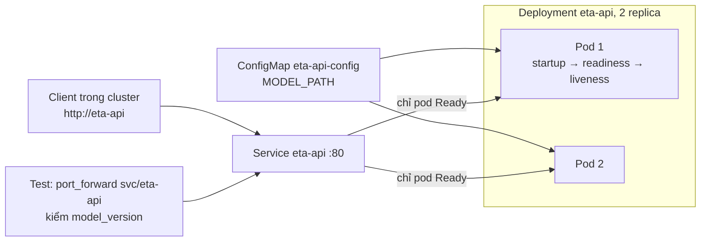
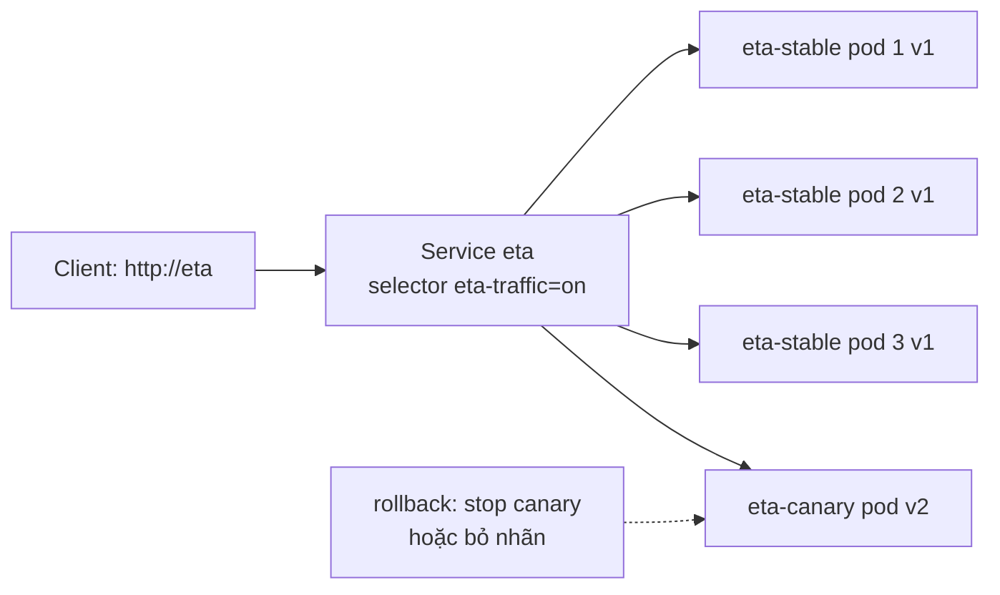
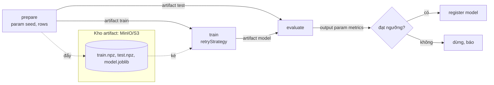
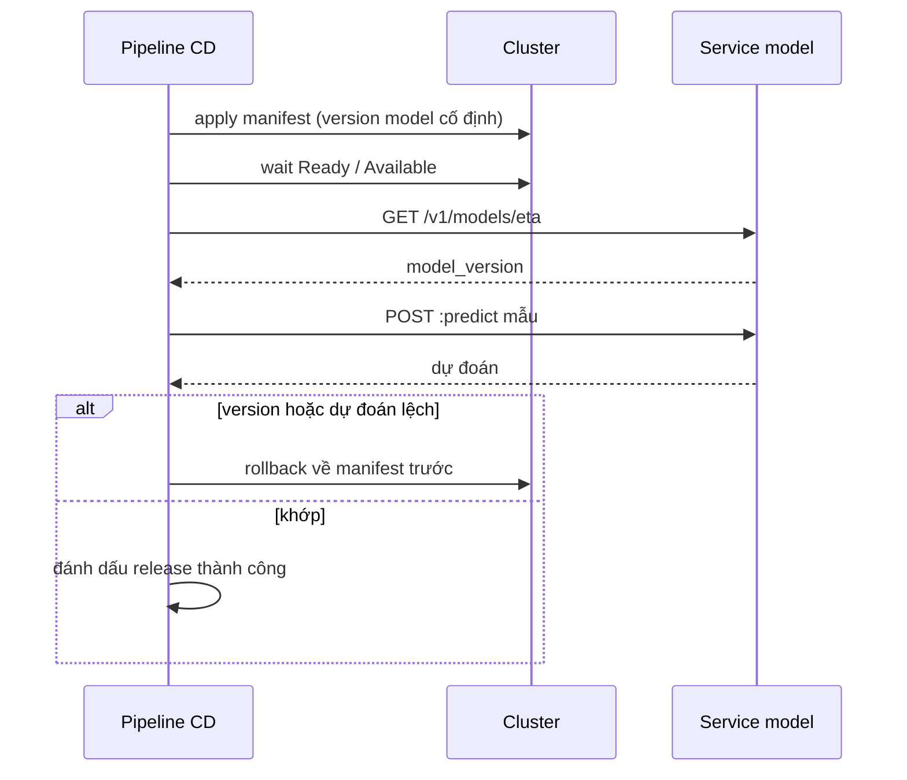

# Kubernetes cho ML

Đến module 12, service ETA chạy bằng Docker Compose trên một máy. Module này đưa nó lên Kubernetes, nhưng chỉ dạy phần **riêng của ML**: service phải nạp model mới nhận request được, model phải được kiểm đúng version sau mỗi lần deploy, canary giữa hai model, pipeline training chạy thành DAG các pod, và GPU là một tài nguyên được lập lịch. Phần Kubernetes chung (RBAC, NetworkPolicy, Helm, vận hành cluster) thuộc track DevOps (module 10-12, đang xây); ở đây chỉ trỏ về.

Mọi bài chạy trên một cluster kind duy nhất tên `mlops` có sẵn KServe và Argo Workflows. Test chấm bằng cluster thật: apply manifest, chờ trạng thái, gọi HTTP vào service trong cluster.

## 0. Cài đặt

Cần Docker đang chạy (đã có từ module 02). `setup/mlops/kind/up.sh` cài `kind` và `kubectl` vào `~/.local/bin`, kiểm sha256 **trước** khi dùng mọi tệp tải về, rồi dựng cluster `mlops` (context `kind-mlops`) với cert-manager, KServe chế độ RawDeployment và Argo Workflows. Không cần `sudo`.

Phiên bản đã kiểm, ngày phát hành và checksum nằm ở **`setup/mlops/kind/versions.env`** (một nguồn duy nhất, module này không chép lại). Chi tiết thành phần, cổng, tài nguyên và cách xử lý sự cố của cluster: [`setup/mlops/kind/README.md`](../../../../setup/mlops/kind/README.md).

| Công cụ | Biến trong `versions.env` | Cài vào |
| --- | --- | --- |
| kind | `KIND_VERSION`, `KIND_SHA256` | `~/.local/bin/kind` |
| kubectl | `KUBECTL_VERSION`, `KUBECTL_SHA256` | `~/.local/bin/kubectl` |
| Node Kubernetes | `KIND_NODE_IMAGE` (ghim theo digest) | container `mlops-control-plane` |
| KServe, cert-manager, Argo | `KSERVE_*`, `CERT_MANAGER_*`, `ARGO_*` | trong cluster |

Muốn tự cài `kind` bằng tay (giống những gì `up.sh` làm):

```bash
source setup/mlops/kind/versions.env
curl -fLo /tmp/kind "https://github.com/kubernetes-sigs/kind/releases/download/${KIND_VERSION}/kind-linux-amd64"
echo "${KIND_SHA256}  /tmp/kind" | sha256sum --check        # phải in "OK" trước khi cài
install -m 0755 /tmp/kind ~/.local/bin/kind
```

`kubectl` tương tự với `https://dl.k8s.io/release/${KUBECTL_VERSION}/bin/linux/amd64/kubectl` và `KUBECTL_SHA256`.

Dựng, xác nhận, gỡ:

```bash
bash setup/mlops/kind/up.sh                               # lần đầu ~6-7 phút, chạy lại an toàn
kind version && kubectl version --client                  # khớp KIND_VERSION, KUBECTL_VERSION
kubectl --context kind-mlops get pods -A                  # mọi pod Running
kubectl --context kind-mlops get clusterservingruntimes   # KServe đã cài
bash setup/mlops/kind/down.sh                             # xoá cluster
rm ~/.local/bin/kind ~/.local/bin/kubectl                 # gỡ hẳn công cụ
rm -rf ~/.cache/mlops-kind                                # xoá cache tải về
```

Luôn ghi `--context kind-mlops` để không lỡ tay chạy vào cluster khác trong kubeconfig. Test làm điều này qua `mlopskit.kubectl`; chưa có cluster thì test **skip** kèm lệnh `bash setup/mlops/kind/up.sh`. Mỗi test tạo namespace riêng `mlops-ex-<uuid8>` và xoá nó khi xong, kể cả khi lỗi; không test nào tạo hay xoá cluster. Cluster dùng chung giữa các bài và capstone: tự thử bằng tay thì tạo namespace của riêng bạn và xoá khi xong, đừng apply vào `default`.

Không dùng thì `docker stop mlops-control-plane` (cluster ăn ~2,3 GB RAM); bật lại bằng `up.sh`.

## 1. Kế thừa từ DevOps và vì sao dùng kind

Module này giả định bạn đã biết các object cơ bản. Nếu chưa, học ở track DevOps rồi quay lại (module 10-12 của track DevOps **đang xây**; trong lúc chờ, dùng tài liệu chính thức ở mục 7); các phần sau **không dạy lại**:

| Chủ đề | Học ở | Module 13 dùng thế nào |
| --- | --- | --- |
| Kiến trúc control plane, Pod, Deployment, Service, Ingress, ConfigMap/Secret cơ bản | DevOps `10-kubernetes-core` | Dùng ngay, chỉ nhấn phần riêng ML (probe cho model nạp chậm, kiểm version) |
| RBAC, ServiceAccount, SecurityContext | DevOps `11-kubernetes-production` | Chỉ dùng RoleBinding có sẵn cho executor Argo |
| NetworkPolicy, quota, PDB, autoscaling chung | DevOps `11-kubernetes-production` | Autoscale cho ML ở module 14 |
| Helm, Kustomize, CRD/Operator | DevOps `11-kubernetes-production` | KServe, Argo là CRD; không viết chart |
| Vận hành cluster: nâng cấp, etcd backup, troubleshooting node | DevOps `10`, `11` | Không đụng; cluster kind dựng lại bằng script |
| GitOps với Argo CD, quản lý secret (SOPS, Vault) | DevOps `12-gitops-secrets` | Giới thiệu ở mục 4, không lab |

**kind** (Kubernetes in Docker) chạy mỗi node K8s là một container Docker. Đủ thật để chạy CRD, webhook, controller (KServe, Argo) và chấm bằng `kubectl`; đủ nhẹ để dựng lại trong vài phút. Giới hạn: không có LoadBalancer cloud, không có GPU passthrough dễ dàng, hiệu năng mạng/đĩa khác cluster thật, một node nên không thấy được scheduling nhiều node. Thay thế: minikube (nhiều driver, addon), k3d/k3s (nhẹ hơn, gần edge), cluster managed (EKS/GKE/AKS) khi cần thứ kind không có.

Image tự build không có trong registry nào; nạp thẳng vào node bằng `kind load` (test dùng `mlopskit.kind_load`). Tag không phải `:latest` thì `imagePullPolicy` mặc định là `IfNotPresent`, kubelet dùng image đã nạp. Đặt `:latest` thì mặc định thành `Always`, kubelet đi kéo từ Docker Hub và pod kẹt `ErrImagePull`: lỗi hay gặp nhất ở buổi đầu dùng kind.

## 2. Từ Compose sang Kubernetes: những gì khác khi service là một model

Ánh xạ thô từ một service trong `compose.yaml`:

| Compose | Kubernetes | Khác biệt đáng chú ý |
| --- | --- | --- |
| `services.api` | Deployment (template pod + số replica) | Pod bị thay bất cứ lúc nào; không có "container của tôi" |
| `ports: 8000:8000` | Service (ClusterIP) chọn pod theo nhãn | Client gọi tên Service, không gọi IP pod |
| `environment`, `env_file` | ConfigMap, Secret (`envFrom`, `valueFrom`) | Pod không tự đọc lại khi ConfigMap đổi; phải rollout |
| `healthcheck` | startupProbe, readinessProbe, livenessProbe | Ba câu hỏi khác nhau, ba hậu quả khác nhau |
| `deploy.resources` | `resources.requests` / `limits` | requests quyết định xếp pod; limits là trần lúc chạy |
| `restart: unless-stopped` | kubelet restart + `CrashLoopBackOff` | Chờ giữa các lần restart tăng dần tới 5 phút |
| `volumes` model | Đóng vào image, PVC, hoặc tải lúc khởi động | hostPath trói pod vào một node |



### Probe cho service phải nạp model

Service ML thường mất từ vài giây tới vài phút để sẵn sàng: tải model từ object storage, giải tuần tự, warm-up. Ba probe trả lời ba câu khác nhau:

| Probe | Câu hỏi | Thất bại thì | Lỗi hay gặp với ML |
| --- | --- | --- | --- |
| `startupProbe` | Đã khởi động xong chưa? | Hết ngân sách (`initialDelaySeconds + periodSeconds × failureThreshold`) thì giết container | Không có, nên liveness giết pod giữa lúc nạp model |
| `readinessProbe` | Nhận traffic được chưa? | Bỏ pod khỏi Endpoints của Service, không giết | Kiểm cổng TCP thay vì "model đã nạp" |
| `livenessProbe` | Có bị treo không? | Giết container | Kiểm cả database/feature store: phụ thuộc chậm làm mọi pod bị giết cùng lúc |

Khi có startupProbe, kubelet tạm hoãn liveness và readiness cho tới khi nó thành công lần đầu. Vì vậy cách đúng cho model nạp chậm là **startupProbe với ngân sách rộng** (gấp đôi thời gian nạp đo được), còn liveness vẫn chặt để phát hiện treo nhanh. Tăng `initialDelaySeconds` của liveness cũng làm pod lên được nhưng áp cho mọi lần khởi động và trộn hai câu hỏi (bài 02 cơ bản).

### requests, limits và QoS

| | CPU | Bộ nhớ |
| --- | --- | --- |
| `requests` | Scheduler cộng requests để xếp pod vào node; tỉ trọng chia CPU khi tranh chấp | Scheduler dùng để xếp pod; cơ sở để chọn pod bị đuổi khi node thiếu |
| `limits` | Vượt thì bị throttle (chạy chậm lại), không chết | Vượt thì kernel giết tiến trình trong container |
| Thiếu cả hai | QoS `BestEffort`: bị đuổi đầu tiên | |
| requests = limits cho mọi container | QoS `Guaranteed`: bị đuổi cuối cùng | |

Model service thường nhạy với latency, nên limit CPU quá thấp biểu hiện thành p95 tăng chứ không thành lỗi; nhiều đội bỏ limit CPU và chỉ giữ requests. Con số requests/limits phải **đo**, không đoán; module 14 đi sâu vào autoscale và quota.

### Đọc trạng thái pod

Thứ tự khi pod không lên: `kubectl get pods` (STATUS, RESTARTS) → `kubectl describe pod` (Events; phần `State` và `Last State` của container: `Reason`, `Exit Code`) → `kubectl logs` và `kubectl logs --previous` (log của lần chạy trước khi restart) → `kubectl get events --sort-by=.lastTimestamp`. Exit code trên 128 nghĩa là tiến trình bị kết thúc bởi tín hiệu số (exit code − 128).

## 3. KServe: InferenceService cho model

KServe là một bộ CRD + controller biến khai báo "tôi muốn phục vụ model này" thành Deployment, Service, (tuỳ chế độ) autoscaler và route. Object trung tâm là `InferenceService`:

```yaml
apiVersion: serving.kserve.io/v1beta1
kind: InferenceService
metadata:
  name: eta
  annotations:
    serving.kserve.io/autoscalerClass: none
spec:
  predictor:
    minReplicas: 1
    maxReplicas: 1
    containers:
      - name: kserve-container
        image: eta-serve:dev
        env:
          - {name: MODEL_PATH, value: /models/eta-v2.joblib}
        readinessProbe:
          httpGet: {path: /v1/models/eta, port: 8080}
```

### Custom container hay runtime có sẵn

| | Runtime có sẵn | Custom container |
| --- | --- | --- |
| Khai báo | `predictor.model.modelFormat: sklearn` + `storageUri` | `predictor.containers` với image của bạn |
| Model đến pod | storage-initializer (init container) tải `storageUri` (`s3://`, `gs://`, `pvc://`, `https://`) vào `/mnt/models` | Đóng vào image, hoặc tự tải |
| Giao thức | KServe v1/v2 (Open Inference Protocol) chuẩn | Bạn tự theo (nên theo v1/v2 để client không đổi) |
| Hợp với | Model định dạng chuẩn, không tiền xử lý riêng | Service có logic feature, kiểm đầu vào, code đã test ở module trước |

`storageUri` tách vòng đời model khỏi image: đổi model là đổi một đường dẫn. Đổi lại: cần quyền đọc kho (Secret + ServiceAccount có annotation của KServe), và **version thật** của model chỉ nằm trong đường dẫn, dễ trỏ nhầm `latest/`. Cluster của module dùng custom container với model đóng sẵn trong image để không phải dựng kho model cho mỗi bài.

### RawDeployment hay Serverless

| | Serverless (Knative) | RawDeployment (cluster của module) |
| --- | --- | --- |
| Thành phần cần | Knative Serving + Istio/Kourier | Không thêm gì |
| Object sinh ra | Knative Service, revision | Deployment + Service + HPA thường |
| Scale về 0 | Có | Không |
| Canary `canaryTrafficPercent` | Có, chia theo revision | **Bị bỏ qua**: rolling update thẳng sang bản mới |
| Hợp với | Nhiều model ít traffic, cần scale về 0 | Ít model, traffic đều, muốn đơn giản để vận hành |

KServe 0.21 gọi RawDeployment là "Standard"; đọc `kubectl get cm -n kserve inferenceservice-config -o yaml` (khoá `deploy`) để biết cluster đang ở chế độ nào **trước khi** tin vào một trường trong spec. Cluster không có metrics-server, nên mọi InferenceService trong bài tắt autoscaler: `serving.kserve.io/autoscalerClass: none` hoặc `minReplicas == maxReplicas` (một trong hai là đủ, cùng luật với capstone M12; không thì HPA báo `<unknown>`).

### Ready chưa đủ: kiểm bằng request

`READY True` của InferenceService nghĩa là Deployment predictor Available, tức container trả lời probe. Nếu probe chỉ là TCP (mặc định KServe thêm cho custom container) thì "Ready" chỉ nói cổng đã mở. Model sai (thiếu `MODEL_PATH` nên service nạp giá trị mặc định, ConfigMap cũ, `storageUri` trỏ nhầm) vẫn Ready. Mọi bài và mọi pipeline CD trong track kiểm sau deploy bằng **request thật**: `GET /v1/models/<tên>` và một `predict` mẫu, so `model_version` và dự đoán với giá trị kỳ vọng (bài trung cấp 01).

### Canary khi không có Knative



Hai InferenceService (stable, canary) gắn chung một nhãn qua `spec.predictor.labels`, một Service chọn theo nhãn đó. kube-proxy chia **theo kết nối**, đều giữa các Endpoints, nên tỉ lệ ≈ số pod canary / tổng số pod (1/4 = 25%). Rút về 0%: annotation `serving.kserve.io/stop: "true"` (KServe xoá Deployment, giữ spec) hoặc đổi nhãn để pod rời Service (pod vẫn ấm). Giới hạn: độ mịn 1/N; client giữ kết nối lâu (keep-alive, gRPC) có thể dính một pod. Cần tỉ lệ chính xác thì dùng L7 (Gateway API `HTTPRoute` có `weight`, service mesh) hoặc chế độ Serverless. Đo tỉ lệ phải từ **trong cluster**: `kubectl port-forward svc/...` chỉ nối tới một pod (bài trung cấp 02).

## 4. Argo Workflows cho pipeline training, Argo CD cho GitOps

Module 05 chạy pipeline training bằng Prefect trên một máy. Trên K8s, mỗi bước là một pod: tài nguyên riêng (bước train xin nhiều CPU/GPU, bước prepare ít), image riêng, retry riêng. Argo Workflows là CRD `Workflow` mô tả DAG các pod.



| Khái niệm | Dùng cho | Ghi chú |
| --- | --- | --- |
| `arguments.parameters` | Giá trị nhỏ: seed, tháng dữ liệu, ngưỡng | Nằm trong object Workflow (etcd), có giới hạn kích thước; dùng được trong `when` |
| artifact (`outputs.artifacts` → `from: {{tasks.X.outputs.artifacts.Y}}`) | Tệp: dữ liệu, model | Executor đẩy lên kho khi bước xong, kéo xuống pod bước sau |
| `dag.tasks[].dependencies` | Thứ tự, song song | Task không phụ thuộc nhau chạy song song |
| `retryStrategy` (`limit`, `retryPolicy`, `backoff`) | Bước hay lỗi hạ tầng (node mất, bị evict, tải dữ liệu chập chờn) | `OnError` chỉ thử lại lỗi hạ tầng; `OnFailure`/`Always` thử lại cả lỗi code |
| output parameter (`valueFrom.path`) | Số liệu nhỏ cho bước sau hoặc cho người đọc | Test đọc từ `status.nodes` |
| `CronWorkflow` | Chạy theo lịch | Thay cron trên máy chủ |

Cluster của module đặt kho artifact mặc định là MinIO trong namespace `argo` và cấp quyền cho executor; Workflow ở namespace tạm của test chạy được ngay (chi tiết ở `setup/mlops/kind/README.md`). Kiểm một Workflow không dừng ở `Succeeded`: đọc output của bước evaluate và so với kết quả kỳ vọng, như kiểm `model_version` của service (bài trung cấp 04).

Argo Workflows hay Prefect/Airflow? Argo mạnh khi mọi bước đã là container và cần tài nguyên K8s (GPU, node riêng); đổi lại viết DAG bằng YAML, debug qua pod. Prefect/Airflow mạnh khi logic Python phức tạp, nhiều tích hợp; có thể chạy từng task thành pod (KubernetesExecutor, Prefect worker K8s). Kubeflow Pipelines dựng trên Argo, thêm SDK Python và theo dõi artifact ML.

**Argo CD** là dự án khác cùng tổ chức Argo: một controller so trạng thái cluster với manifest trong Git và đồng bộ (GitOps). Với ML, nó trả lời "model nào đang chạy production" bằng một commit: pipeline training ghi version model mới vào manifest (PR), người duyệt merge, Argo CD rollout; rollback là revert commit. Cài đặt, ApplicationSet, quản lý secret với GitOps học ở DevOps `12-gitops-secrets` (track DevOps, đang xây); module này không lab Argo CD.

## 5. GPU trên Kubernetes ở mức khái niệm

Máy học không có NVIDIA runtime trong Docker và kind không chuyển GPU vào node dễ dàng, nên phần này chỉ ở mức khái niệm; bài GPU có đường CPU ở module 11, 15.

| Khái niệm | Ý nghĩa |
| --- | --- |
| NVIDIA device plugin (DaemonSet) | Quảng bá extended resource `nvidia.com/gpu` của mỗi node cho scheduler |
| `resources.limits: {nvidia.com/gpu: 1}` | Xin một GPU nguyên; extended resource khai ở `limits` (requests tự bằng), số nguyên |
| GPU Operator | Cài driver, container toolkit, device plugin, DCGM exporter thành một khối |
| Taint/toleration, nodeSelector | Giữ node GPU cho workload GPU, không để pod CPU chiếm |
| Time-slicing, MIG | Chia một GPU cho nhiều pod: time-slicing không cô lập bộ nhớ; MIG (A100/H100) chia phần cứng |
| DCGM exporter | Metric GPU (sử dụng, bộ nhớ, nhiệt độ) cho Prometheus |

Quyết định thực tế: node GPU đắt, nên hai lỗi tốn tiền nhất là pod CPU chạy trên node GPU (thiếu taint) và GPU nhàn rỗi vì pod giữ card mà không dùng (notebook để mở, serving traffic thấp). Serving model nhỏ như ETA chạy CPU rẻ hơn; GPU đáng giá với deep learning (module 11) và distributed training (module 15). Hàng đợi và chia quota GPU giữa các đội (Kueue) ở module 14.

## 6. Kiểm chứng và vận hành: những thói quen của module

- **Chấm bằng cluster thật, kiểm bằng request.** Ready, Available, Succeeded là điều kiện cần. Điều kiện đủ là `model_version` và dự đoán đúng qua Service, output của evaluate khớp tính lại, tỉ lệ canary đo từ trong cluster.
- **Namespace riêng cho mỗi lần chạy**, xoá trong `finally`; không bao giờ dọn theo nhãn chung (người khác cũng dùng cluster). Kiểm rác bằng `mlopskit.leftovers()`.
- **Cứng hoá pod serving**: `automountServiceAccountToken: false` (service không gọi API Kubernetes; ServiceAccount `default` có thể đã được gắn quyền), non-root, `allowPrivilegeEscalation: false`, `capabilities.drop: [ALL]`, seccomp `RuntimeDefault`, root filesystem chỉ đọc. Chi tiết SecurityContext và Pod Security Standards ở track DevOps; bài cơ bản 01 bắt bốn trường đầu.
- **Ghim image theo tag cụ thể**, production theo digest; `:latest` đổi `imagePullPolicy` và làm rollback mơ hồ.
- **Mỗi bản model mới là một bản release**: đi qua cùng cổng staging như thay đổi code (deploy thật, smoke test, latency, version) chứ không chỉ so accuracy.
- **Chẩn đoán từ trạng thái, không đoán**: `describe` (Events, `Last State`), `logs --previous`, `get events`; với InferenceService và Workflow, xem object con mà controller sinh ra (`get deploy`, `status.nodes`).



Các bài: Deployment + Service + ConfigMap (cơ bản 01), startupProbe (cơ bản 02), trắc nghiệm (cơ bản 03), InferenceService custom predictor (trung cấp 01), canary và rollback (trung cấp 02), sự cố pod bị kill lặp lại (trung cấp 03), Argo Workflow (trung cấp 04), kế hoạch chuyển ETA sang K8s và review manifest (nâng cao). Capstone m12 đưa ETA lên kind + KServe.

## 7. Tài liệu tham khảo

- Kubernetes: [Configure Liveness, Readiness and Startup Probes](https://kubernetes.io/docs/tasks/configure-pod-container/configure-liveness-readiness-startup-probes/), [Resource Management for Pods and Containers](https://kubernetes.io/docs/concepts/configuration/manage-resources-containers/), [Pod Quality of Service Classes](https://kubernetes.io/docs/concepts/workloads/pods/pod-qos/), [Debug Pods](https://kubernetes.io/docs/tasks/debug/debug-application/debug-pods/), [Schedule GPUs](https://kubernetes.io/docs/tasks/manage-gpus/scheduling-gpus/)
- kind: [Quick Start](https://kind.sigs.k8s.io/docs/user/quick-start/), [Loading an Image Into Your Cluster](https://kind.sigs.k8s.io/docs/user/quick-start/#loading-an-image-into-your-cluster)
- KServe: [Documentation](https://kserve.github.io/website/), [Raw Deployment / Standard mode](https://kserve.github.io/website/docs/admin-guide/kubernetes-deployment), [Custom Predictor](https://kserve.github.io/website/docs/model-serving/predictive-inference/frameworks/custom-predictor), [Canary Rollout](https://kserve.github.io/website/docs/model-serving/predictive-inference/rollout-strategies/canary)
- Argo: [Argo Workflows](https://argo-workflows.readthedocs.io/en/latest/), [Artifacts](https://argo-workflows.readthedocs.io/en/latest/walk-through/artifacts/), [Retrying Failed or Errored Steps](https://argo-workflows.readthedocs.io/en/latest/retries/), [Argo CD](https://argo-cd.readthedocs.io/en/stable/)
- NVIDIA: [GPU Operator](https://docs.nvidia.com/datacenter/cloud-native/gpu-operator/latest/index.html), [k8s-device-plugin](https://github.com/NVIDIA/k8s-device-plugin)
- Chip Huyen, *Designing Machine Learning Systems* (O'Reilly, 2022), chương 7 (deployment) và 10 (infrastructure)
- [roadmap.sh/mlops](https://roadmap.sh/mlops) (mục Kubernetes, orchestration)
