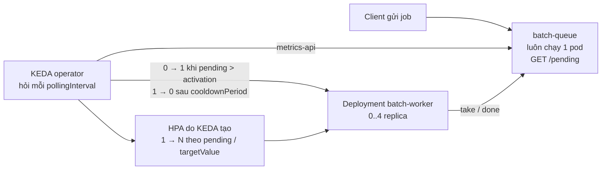
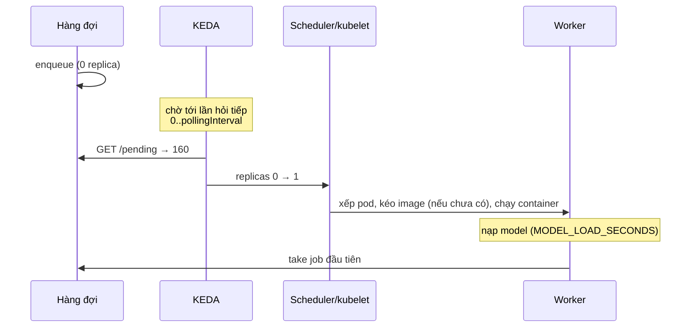
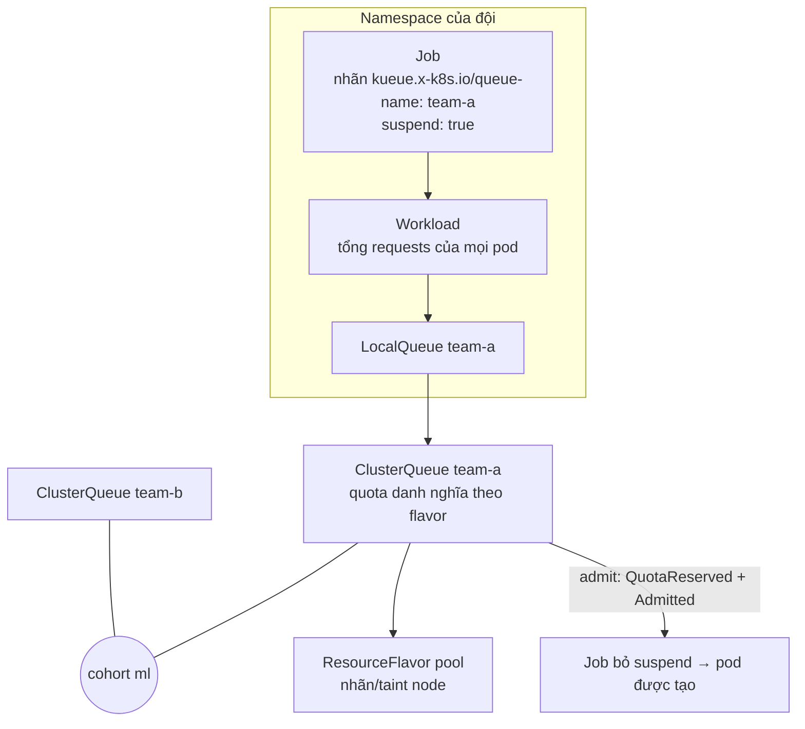
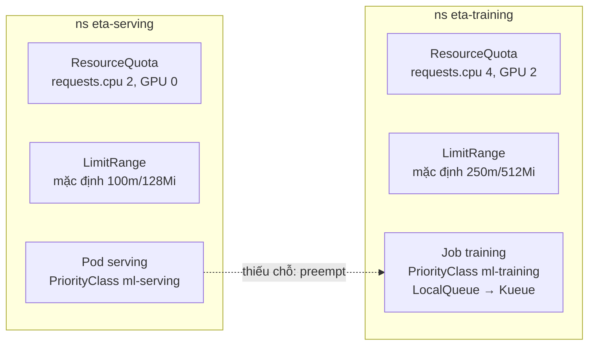

# Kubernetes cho ML production

Module 13 đưa service ETA lên Kubernetes với số replica cố định và một model mỗi lần. Module này mở đầu tầng senior: những câu hỏi xuất hiện khi nhiều model, nhiều đội và GPU đắt tiền dùng chung một cluster. Tải tăng thì thêm replica theo tín hiệu nào, và scale về 0 thì trả giá cold start bao nhiêu? Một service dưới tải trả p95 bao nhiêu theo số replica? Job training xếp hàng chờ GPU thế nào cho công bằng giữa các đội? Ai được đẩy ai ra khi thiếu chỗ?

Nói thẳng: đây là **kiến thức**, không thay được kinh nghiệm vận hành cluster production. Lab chạy trên một node kind trong laptop. GPU là extended resource giả (một con số trên node, không có card thật), "nhiều đội" là vài namespace, tải là vài chục request mỗi giây. Multi-GPU, MIG, time-slicing và cluster nhiều node thật chỉ ở mức khái niệm, hoặc được đo và mô phỏng trên lab. Mục tiêu là bạn hiểu đúng cơ chế và biết đọc trạng thái. Khi gặp cluster thật, bạn có khung để học nhanh, không phải bắt đầu từ đầu.

## 0. Cài đặt

Cần cluster `mlops` của module 13 (mục 0 module 13) cộng ba add-on senior. Một lệnh, chạy lại an toàn, không đổi current-context của kubectl:

```bash
bash setup/mlops/kind/up.sh --senior        # lần đầu thêm ~2 phút, chạy lại ~10 giây
kubectl --context kind-mlops get crd scaledobjects.keda.sh clusterqueues.kueue.x-k8s.io
kubectl --context kind-mlops top node       # metrics-server trả số
```

| Thành phần | Biến trong `setup/mlops/kind/versions.env` | Namespace | Dùng ở bài |
| --- | --- | --- | --- |
| metrics-server | `METRICS_SERVER_VERSION`, `METRICS_SERVER_SHA256` | `kube-system` | `kubectl top`, HPA theo CPU/RAM (mục 1) |
| KEDA | `KEDA_VERSION`, `KEDA_SHA256` | `keda` | Trung cấp 01 |
| Kueue | `KUEUE_VERSION`, `KUEUE_SHA256` | `kueue-system` | Trung cấp 02, 04 |

Phiên bản, ngày phát hành, checksum và số đo bộ nhớ (+0,55 GiB khi rảnh) ở [`setup/mlops/kind/README.md`](../../../../setup/mlops/kind/README.md#add-on-senior---senior). Cluster thiếu add-on thì test **skip** kèm đúng lệnh trên. Gỡ add-on mà giữ cluster: không có lệnh riêng, chạy `bash setup/mlops/kind/down.sh` rồi `up.sh` (không `--senior`).

**Lưu ý webhook Kueue.** Kueue cài webhook `failurePolicy: Fail` cho **mọi** `batch/v1` Job ngoài `kube-system`, `kueue-system`, kể cả Job không dùng hàng đợi. Ngay sau khi node khởi động lại (bật máy, `docker start mlops-control-plane`), controller Kueue chưa lên. Trong lúc đó mọi lệnh tạo Job bị từ chối với `failed calling webhook "mjob.kb.io" ... connection refused`, thường trong 30–60 giây. Cách chờ:

```bash
kubectl --context kind-mlops -n kueue-system wait --for=condition=Available deployment/kueue-controller-manager --timeout=180s
```

Test không cần bạn chờ: `mlopskit.require_senior_addons()` thử tạo một đối tượng qua webhook (`--dry-run=server`) tới khi được, tối đa 120 giây. Trên cluster thật, một webhook `Fail` của add-on chặn cả workload không liên quan là rủi ro vận hành: phải giám sát và chạy nhiều replica cho controller.

Cluster dùng chung giữa các bài (và có thể giữa nhiều người chạy test song song): test chỉ tạo namespace `mlops-ex-<uuid8>`. Tài nguyên cluster-scoped (ClusterQueue, ResourceFlavor, PriorityClass) có hậu tố `<uuid8>` nhờ `__RUN__` trong manifest và được xoá khi xong. GPU giả trên node có tên riêng theo lần chạy và được gỡ khi xong. Tự thử bằng tay thì làm theo đúng quy ước đó. **Không bao giờ** đặt `globalDefault: true` cho PriorityClass trên cluster dùng chung.

## 1. Autoscaling inference: tín hiệu nào, scale-to-zero và cold start

### HPA theo resource hay theo custom metric

HorizontalPodAutoscaler (HPA) tính số replica mong muốn bằng `ceil(replica hiện tại × giá trị đo / giá trị mục tiêu)`, chu kỳ 15 giây. Câu hỏi khó là **đo cái gì**:

| Tín hiệu | Nguồn | Hợp với | Sai ở đâu với ML |
| --- | --- | --- | --- |
| CPU/RAM sử dụng (`Resource`) | metrics-server | Service CPU-bound, tải đều | Model chạy GPU hoặc chờ I/O (gọi feature store) thì CPU thấp mà latency đã cao; RAM của model gần như hằng số |
| Request đang xử lý, RPS mỗi pod (`Pods`/`Object`) | Prometheus + prometheus-adapter | Online serving | Cần chạy và giữ adapter; metric từ pod, nên không có pod thì không có metric |
| Độ dài hàng đợi, lag Kafka (`External`) | Hệ hàng đợi | Batch/async inference, worker | Mục tiêu "N việc mỗi worker" phải đo từ thời gian xử lý thật |
| p95 latency | Prometheus | Hầu như không nên | Latency tăng vì phụ thuộc chậm thì thêm replica không giúp, còn làm phụ thuộc chậm thêm |

Mỗi lần thêm replica cho model cũng tốn thời gian khởi động: tải image (có thể vài GB), nạp model, warm-up. Vì vậy HPA cho ML thường scale **lên sớm** (mục tiêu thấp, không chờ lâu) và scale **xuống chậm** (`behavior.scaleDown.stabilizationWindowSeconds`, mặc định 300 giây) để không dao động.

HPA theo custom metric qua prometheus-adapter và **KServe Serverless** (Knative, scale theo concurrency, scale về 0) chỉ ở mức khái niệm trong module này. Cluster chạy KServe RawDeployment (module 13 mục 3), và dựng thêm Knative cùng Istio/Kourier vượt ngân sách laptop. Thực hành dùng **KEDA**.

### KEDA và scale-to-zero

KEDA là một operator đứng giữa nguồn metric và HPA. Bạn khai `ScaledObject` (đích là một Deployment, danh sách trigger: Prometheus, Kafka, Redis, `metrics-api` đọc một endpoint JSON...). KEDA tạo một HPA với metric `External` do chính KEDA phục vụ. KEDA còn tự làm việc mà HPA không làm: **kích hoạt từ 0 lên 1 và đưa về 0**.



| Trường | Ý nghĩa | Bài trung cấp 01 |
| --- | --- | --- |
| `minReplicaCount: 0` | Cho phép về 0 khi mọi trigger không active | Bắt buộc |
| `activationTargetValue` | Metric vượt ngưỡng này thì kích hoạt 0 → 1 | Mặc định 0: có job là kích hoạt |
| `targetValue` | Mục tiêu mỗi replica cho HPA (giá trị trung bình) | 10 job chưa xong mỗi worker |
| `pollingInterval` | KEDA hỏi metric mỗi bao giây (mặc định 30) | Phần lớn của cold start khi ở 0 |
| `cooldownPeriod` | Không active bao lâu thì về 0 (mặc định 300) | Chỉ áp cho bước 1 → 0 |

**Điều kiện tiên quyết của scale-to-zero:** metric phải đến từ thứ **vẫn tồn tại khi không có pod nào**. Nếu metric do chính pod model xuất (RPS, in-flight), về 0 thì không còn ai báo có tải, và service không bao giờ dậy lại. Vì vậy bài lab dùng hàng đợi đứng trước worker. Ngoài đời, hàng đợi là Kafka/SQS/Redis (lag là metric), hoặc một proxy giữ request trong lúc chờ pod lên: KEDA HTTP add-on, activator của Knative.

### Cold start và cách giảm

Cold start là thời gian từ lúc có việc tới lúc pod đầu tiên xử lý được việc đó. Bài trung cấp 01 đo nó bằng queue: từ lúc enqueue khi đang 0 replica tới lúc job đầu tiên được lấy. Thành phần:



| Thành phần | Cách giảm | Đánh đổi |
| --- | --- | --- |
| Chờ phát hiện tải | `pollingInterval` ngắn; proxy giữ request và báo ngay | Hỏi nhiều hơn vào nguồn metric |
| Kéo image | Image nhỏ (module 02), pre-pull bằng DaemonSet, image streaming/lazy loading | Thêm thành phần vận hành |
| Khởi động runtime + nạp model | Model nhỏ hơn (quantize, distill), định dạng nạp nhanh (safetensors, mmap), cache model trên node (KServe LocalModel, PVC) | Công sức tối ưu, thêm đĩa node |
| Warm-up (JIT, CUDA graph, cache) | Warm-up trong startupProbe trước khi nhận traffic | Cold start dài hơn nhưng request đầu không chậm |
| Không cần về 0 | `minReplicaCount: 1` cho model có SLO latency; về 0 chỉ cho model ít dùng hoặc batch | Trả tiền một pod rảnh |

Quyết định "có về 0 hay không" là bài toán chi phí và SLO, không phải kỹ thuật: một pod CPU rảnh rẻ, một node GPU rảnh thì đắt. Bài nâng cao 02 yêu cầu bạn lập kế hoạch giảm cold start bằng số đo.

## 2. Serving dưới tải: p95 và thông lượng theo số replica, Triton

### Đo trước khi chỉnh

Một service model có **trần thông lượng mỗi pod**. Pod xử lý một request mất `t` giây và chạy song song tối đa `c` request (model server một worker thì `c = 1`), nên trần là khoảng `c / t` request mỗi giây. Vượt trần thì request xếp hàng: latency tăng theo độ dài hàng đợi, thông lượng đứng yên. Bài trung cấp 03 làm đúng phép đo này: InferenceService custom predictor (`SERVICE_MS=20`, `CONCURRENCY=1`, trần ~50 req/s mỗi pod), k6 chạy 8 VU trong 15 giây, đo ở 1 rồi 3 replica.

| Đại lượng (đo trên laptop, tham khảo) | 1 replica | 3 replica |
| --- | --- | --- |
| Thông lượng | ~49 req/s | ~95–145 req/s |
| p95 | ~170 ms | ~60–105 ms |

Hai điều số đo dạy:

- **Cân bằng tải theo kết nối.** kube-proxy chọn pod lúc **mở kết nối**. k6 (cũng như hầu hết client) giữ kết nối keep-alive, nên 8 VU là 8 kết nối chia ngẫu nhiên cho 3 pod: có lần một pod không nhận kết nối nào và thông lượng chỉ gấp đôi. Client gRPC, HTTP/2 còn dính chặt hơn. Muốn đều thì cân bằng ở L7 (Gateway API, service mesh, router của KServe/Triton) hoặc tăng số kết nối.
- **Không đo qua `kubectl port-forward`.** Port-forward nối vào **một** pod. Test của bài tạo Service `NodePort` và chạy k6 trong mạng Docker `kind` (`mlopskit.k6_run(..., network="kind")`), nên request đi qua kube-proxy như client thật trong cluster.

Kế hoạch capacity đi từ số đo: cần `R` req/s ở đỉnh, mỗi pod chịu được `r` req/s ở p95 đạt SLO. Số replica tối thiểu là `ceil(R / r)` cộng phần dự phòng (mất một node, rolling update). Rồi mới đặt `minReplicas`/`maxReplicas` và ngưỡng autoscale.

### Triton Inference Server trên K8s

Triton là model server của NVIDIA: một tiến trình phục vụ nhiều model và nhiều backend (ONNX Runtime, TensorRT, PyTorch, Python, OpenVINO) qua giao thức KServe v2 (HTTP 8000, gRPC 8001, metric Prometheus 8002).

| Khái niệm | Ở đâu | Ý nghĩa |
| --- | --- | --- |
| Model repository | `/models/<tên>/config.pbtxt`, `/models/<tên>/<version>/model.*` | Mount từ PVC, object storage (`s3://`, `gs://`) hoặc ConfigMap (lab). Mỗi version một thư mục số |
| `max_batch_size` | `config.pbtxt` | > 0 thì chiều đầu của tensor là batch và Triton được gộp request |
| `dynamic_batching` | `config.pbtxt` | Gộp các request đến gần nhau thành một batch. `max_queue_delay_microseconds` là thời gian tối đa chờ thêm request |
| `instance_group` | `config.pbtxt` | Số bản model chạy song song và đặt ở đâu (`KIND_CPU`, `KIND_GPU`, `gpus: [0]`) |
| Metric | `:8002/metrics` | `nv_inference_request_success`, `nv_inference_exec_count` (số lần chạy model), `nv_inference_queue_duration_us` |

Dynamic batching đổi một ít latency (thời gian chờ trong hàng) lấy thông lượng. Trên GPU, một batch 16 thường tốn gần bằng batch 1. Trên CPU, lợi ích nhỏ hơn và phụ thuộc model. Dấu hiệu batching có tác dụng: `nv_inference_exec_count` nhỏ hơn hẳn `nv_inference_request_success`. Chỉnh theo thứ tự: đo p95 khi chưa bật, bật với `max_queue_delay_microseconds` nhỏ (vài ms, trong ngân sách latency), rồi tăng `instance_group.count` khi một instance đã bão hoà.

**Vì sao bài Triton mặc định skip:** image nhỏ nhất có server là `nvcr.io/nvidia/tritonserver:26.09-py3`, **9,04 GB nén** (đo 2026-11-04). Không có bản CPU-only. Giải nén và `kind load` cần gấp nhiều lần dung lượng đó, vượt ngân sách đĩa và thời gian của module. Bài trung cấp 03 vẫn yêu cầu viết `config.pbtxt` (test tĩnh luôn chạy). Phần chạy Triton thật dưới k6 chỉ chạy khi bạn `docker pull` image trước và đặt `MLOPS_TRITON=1`. Load test bắt buộc chạy trên KServe custom predictor.

## 3. GPU scheduling: device plugin, extended resource, chia GPU

Kubernetes không biết GPU là gì. Nó chỉ biết **extended resource**: một tên miền/tên (`nvidia.com/gpu`) với một số nguyên trên mỗi node. Scheduler cộng và trừ con số đó như CPU.

| Khái niệm | Cơ chế | Hệ quả |
| --- | --- | --- |
| Device plugin (DaemonSet) | Đăng ký với kubelet, quảng bá `nvidia.com/gpu: N`, khi pod chạy thì gắn thiết bị `/dev/nvidia*` vào container | Không có plugin thì node có card cũng báo 0 GPU |
| Extended resource trong pod | Khai ở `limits` (requests tự bằng limits), **số nguyên**, không overcommit | Không xin được 0,5 GPU; pod giữ card suốt đời kể cả khi rảnh |
| GPU Operator | Cài driver, container toolkit, device plugin, DCGM exporter, MIG manager | Một khối vận hành thay vì năm |
| Time-slicing | Device plugin quảng bá mỗi card thành N "bản sao"; các pod chia thời gian | Không cô lập bộ nhớ, một pod OOM làm hỏng pod khác; hợp dev/notebook |
| MPS | Nhiều tiến trình chạy đồng thời trên một GPU, có giới hạn bộ nhớ | Cô lập lỗi kém hơn MIG |
| MIG (A100, H100...) | Chia phần cứng thành tối đa 7 instance (vd. `nvidia.com/mig-1g.10gb`) | Cô lập thật; cấu hình cố định theo profile; không phải card nào cũng có |
| Taint, toleration, nodeSelector, node affinity | Giữ node GPU cho pod cần GPU | Thiếu taint thì pod CPU chiếm node đắt |
| DRA (Dynamic Resource Allocation) | API mới (`ResourceClaim`) mô tả thiết bị chi tiết hơn một con số | Đang thay dần extended resource cho GPU |

Lab không có GPU trong kind. `mlopskit.fake_extended_resource("gpu", 4)` patch `status.capacity` của node thêm `mlops.example/gpu-<uuid8>: 4` (tên riêng mỗi lần chạy, gỡ khi xong). Scheduler, ResourceQuota và Kueue xử lý con số này y như `nvidia.com/gpu`. Không có card nào được gắn vào container, nên lab dạy được **lập lịch và quota**, không dạy được driver, bộ nhớ GPU hay hiệu năng. Manifest trong bài viết `__GPU__`, test thay bằng tên thật.

Lỗi tốn tiền hay gặp: GPU nhàn rỗi vì pod giữ card mà không dùng (notebook để mở, service traffic thấp chạy cả card), job xin 8 GPU trên node 8 card nên chỉ xếp được lúc node trống hoàn toàn (fragmentation), và pod CPU chiếm node GPU. Các cơ chế ở mục 4, 5 (hàng đợi, quota, priority) giải quyết phần "ai được dùng khi nào". Time-slicing, MIG giải quyết phần "một card cho nhiều pod".

## 4. Hàng đợi batch job bằng Kueue

Scheduler mặc định xếp **pod**, ngay khi tạo, nếu có chỗ. Với job training điều đó sai theo ba cách. Job 4 worker có thể chỉ chạy được 2 worker rồi giữ GPU chờ 2 cái còn lại (deadlock một phần). Không có khái niệm "quota của đội" theo thời gian. Không có thứ tự công bằng khi nhiều đội cùng chờ. **Kueue** thêm một lớp **admission theo cả job**: Job được tạo ở trạng thái `suspend: true`. Kueue tạo một `Workload` tương ứng, cộng requests của mọi pod, kiểm quota. Chỉ khi cả job vừa quota thì Kueue mới bỏ suspend và pod mới được tạo.



| Object | Phạm vi | Vai trò |
| --- | --- | --- |
| `ResourceFlavor` | Cluster | Một loại tài nguyên: nhãn node (vd. `gpu-type: a100`), taint, toleration. Kueue gắn nodeSelector của flavor vào pod khi admit |
| `ClusterQueue` | Cluster | Quota `nominalQuota` theo (flavor, resource), `coveredResources`, `namespaceSelector` (mặc định **không** namespace nào), `queueingStrategy`, `preemption`, `cohortName` |
| `LocalQueue` | Namespace | Điểm đội gửi job vào; trỏ một ClusterQueue |
| `Workload` | Namespace | Đơn vị admission; condition `QuotaReserved`, `Admitted`, `Evicted`, `Finished`; message giải thích vì sao chưa admit |
| `WorkloadPriorityClass` | Cluster | Ưu tiên riêng cho Kueue, tách khỏi ưu tiên của pod |

**Borrowing.** Các ClusterQueue cùng `cohortName` cho nhau mượn phần quota chưa dùng. `borrowingLimit` giới hạn một đội mượn tối đa bao nhiêu, `lendingLimit` giới hạn một đội cho mượn bao nhiêu. Mượn giúp GPU không nằm không. Nhưng chủ quota quay lại thì sao? `preemption.reclaimWithinCohort` (`Never`, `LowerPriority`, `Any`) quyết định đội chủ có được đẩy workload đang mượn ra để lấy lại phần danh nghĩa không. Workload bị đẩy được `Evicted`, Job bị suspend lại, pod bị xoá và xếp hàng lại từ đầu. Vì vậy job training phải **checkpoint được** (module 15).

**Đọc trạng thái khi job không chạy:** `kubectl get workloads -n <ns>` (cột `ADMITTED`), `kubectl describe workload <tên>` (condition `QuotaReserved` và message của nó), `kubectl get clusterqueue <tên> -o yaml` (`status.flavorsUsage`, `pendingWorkloads`). Pod không tồn tại không có nghĩa là scheduler lỗi: với Kueue, pod chỉ được tạo **sau** admission. Bài trung cấp 02 thực hành quota, mượn và đòi lại; bài trung cấp 04 là sự cố.

Thay thế: Volcano (gang scheduling, nhiều tính năng HPC, scheduler riêng), YuniKorn (hàng đợi phân cấp, gốc Hadoop YARN), Ray/KubeRay có autoscaler riêng, scheduler của Slurm khi cluster là HPC. Kueue chọn cách **không thay scheduler**: chỉ quyết định khi nào job được bắt đầu, để kube-scheduler xếp pod như thường.

## 5. Multi-tenant: namespace, ResourceQuota, LimitRange, PriorityClass, preemption

Một cluster nhiều đội cần trả lời bốn câu: ai được dùng bao nhiêu, pod không khai tài nguyên thì sao, ai được ưu tiên khi thiếu chỗ, và ai không được thấy ai.

| Cơ chế | Câu hỏi | Lưu ý cho ML |
| --- | --- | --- |
| Namespace | Ranh giới quản trị: quota, RBAC, NetworkPolicy theo namespace | Tách **serving** và **training** dù cùng một đội: hai loại tải có SLO khác nhau |
| `ResourceQuota` | Tổng requests/limits, số object trong namespace | Extended resource chỉ quota được ở dạng `requests.<tên>` (vd. `requests.nvidia.com/gpu: 0` cấm namespace serving xin GPU). Quota có CPU/RAM thì mọi pod **phải** khai các trường đó, nếu không bị từ chối |
| `LimitRange` | Mặc định và trần cho từng container | `defaultRequest`/`default` cho pod không khai; `max` chặn container đòi quá nhiều. Đi cặp với ResourceQuota |
| `PriorityClass` | Pod nào quan trọng hơn | `value` cao hơn thì xếp trước trong hàng chờ của scheduler. `preemptionPolicy: Never` thì xếp trước nhưng không đẩy ai. Giá trị từ 1 tỉ trở lên dành cho class hệ thống |
| Preemption của scheduler | Thiếu chỗ cho pod ưu tiên cao | Scheduler xoá pod ưu tiên thấp hơn (có `terminationGracePeriodSeconds`), condition `DisruptionTarget`. PodDisruptionBudget chỉ được tôn trọng ở mức cố gắng |
| Preemption của Kueue | Thiếu quota cho workload | Theo `WorkloadPriorityClass` và chính sách `preemption` của ClusterQueue; đẩy cả job, không từng pod |

Thứ tự ưu tiên thường gặp: serving online > batch inference có hạn > training chạy lại được > notebook/thử nghiệm. Có một ngoại lệ đáng nhớ là **ưu tiên cao mà không preempt**. Notebook của nhà nghiên cứu nên được xếp trước training khi có chỗ trống, nhưng không được giết một job training 20 giờ để mở notebook. Bài cơ bản 02 thực hành đúng bộ ba này. Bài cơ bản 01 tách quota serving và training.



Cô lập mạnh hơn namespace (vCluster, cluster riêng mỗi đội, node pool riêng theo taint) đáng giá khi đội không tin nhau hoặc có yêu cầu tuân thủ. Đổi lại là chi phí vận hành và GPU khó chia hơn. Bài nâng cao 01 yêu cầu thiết kế điều này cho 3 đội dùng chung GPU.

## 6. Ôn nhanh RBAC, NetworkPolicy, Helm (kế thừa từ DevOps)

Phần K8s chung thuộc [track DevOps](../../../devops/README.md), module 10–12 (**đang xây**). Module này không dạy lại, chỉ nhắc chỗ chúng chạm vào nền tảng ML:

- **RBAC:** đội A được tạo Job và đọc Workload trong namespace của mình, **không** được sửa ClusterQueue hay PriorityClass (cluster-scoped, thuộc đội platform). Kueue cài sẵn ClusterRole `kueue-batch-user-role`, `kueue-batch-admin-role` để gắn bằng RoleBinding. Pod serving không cần token API (`automountServiceAccountToken: false`, như module 13).
- **NetworkPolicy:** namespace training không gọi được service serving của đội khác. Chỉ hàng đợi/gateway được gọi worker. Nhớ mở chiều KEDA → nguồn metric và Prometheus → `/metrics`, nếu không autoscale "chết lặng".
- **Helm:** KEDA, Kueue, GPU Operator, Triton đều phát hành chart. Cluster lab cài từ manifest đã ghim checksum (`up.sh`) để thấy rõ từng object. Production thường dùng chart ghim phiên bản, quản lý qua GitOps (Argo CD, module 13 mục 4).

## 7. Tài liệu tham khảo

- Kubernetes: [Horizontal Pod Autoscaling](https://kubernetes.io/docs/tasks/run-application/horizontal-pod-autoscale/), [Resource Quotas](https://kubernetes.io/docs/concepts/policy/resource-quotas/), [Limit Ranges](https://kubernetes.io/docs/concepts/policy/limit-range/), [Pod Priority and Preemption](https://kubernetes.io/docs/concepts/scheduling-eviction/pod-priority-preemption/), [Schedule GPUs](https://kubernetes.io/docs/tasks/manage-gpus/scheduling-gpus/), [Extended resources](https://kubernetes.io/docs/tasks/administer-cluster/extended-resource-node/), [Dynamic Resource Allocation](https://kubernetes.io/docs/concepts/scheduling-eviction/dynamic-resource-allocation/)
- KEDA: [Concepts: Scaling Deployments](https://keda.sh/docs/latest/concepts/scaling-deployments/), [Metrics API scaler](https://keda.sh/docs/latest/scalers/metrics-api/), [HTTP add-on](https://github.com/kedacore/http-add-on)
- Kueue: [Overview](https://kueue.sigs.k8s.io/docs/overview/), [Cluster Queue](https://kueue.sigs.k8s.io/docs/concepts/cluster_queue/), [Preemption](https://kueue.sigs.k8s.io/docs/concepts/preemption/), [Run a Job](https://kueue.sigs.k8s.io/docs/tasks/run/jobs/), [Troubleshooting](https://kueue.sigs.k8s.io/docs/tasks/troubleshooting/)
- NVIDIA: [Triton model configuration](https://docs.nvidia.com/deeplearning/triton-inference-server/user-guide/docs/user_guide/model_configuration.html), [Dynamic batching](https://docs.nvidia.com/deeplearning/triton-inference-server/user-guide/docs/user_guide/batcher.html), [Triton metrics](https://docs.nvidia.com/deeplearning/triton-inference-server/user-guide/docs/user_guide/metrics.html), [GPU Operator](https://docs.nvidia.com/datacenter/cloud-native/gpu-operator/latest/index.html), [Time-slicing GPUs](https://docs.nvidia.com/datacenter/cloud-native/gpu-operator/latest/gpu-sharing.html), [MIG User Guide](https://docs.nvidia.com/datacenter/tesla/mig-user-guide/)
- KServe: [Autoscaling](https://kserve.github.io/website/docs/model-serving/predictive-inference/autoscaling/), [Raw Deployment / Standard mode](https://kserve.github.io/website/docs/admin-guide/kubernetes-deployment)
- k6: [Scenarios and executors](https://grafana.com/docs/k6/latest/using-k6/scenarios/), [Thresholds](https://grafana.com/docs/k6/latest/using-k6/thresholds/)
- Chip Huyen, *Designing Machine Learning Systems* (O'Reilly, 2022), chương 10 (infrastructure and tooling)
- [roadmap.sh/mlops](https://roadmap.sh/mlops) (mục orchestration, scaling)
