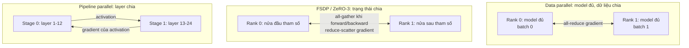
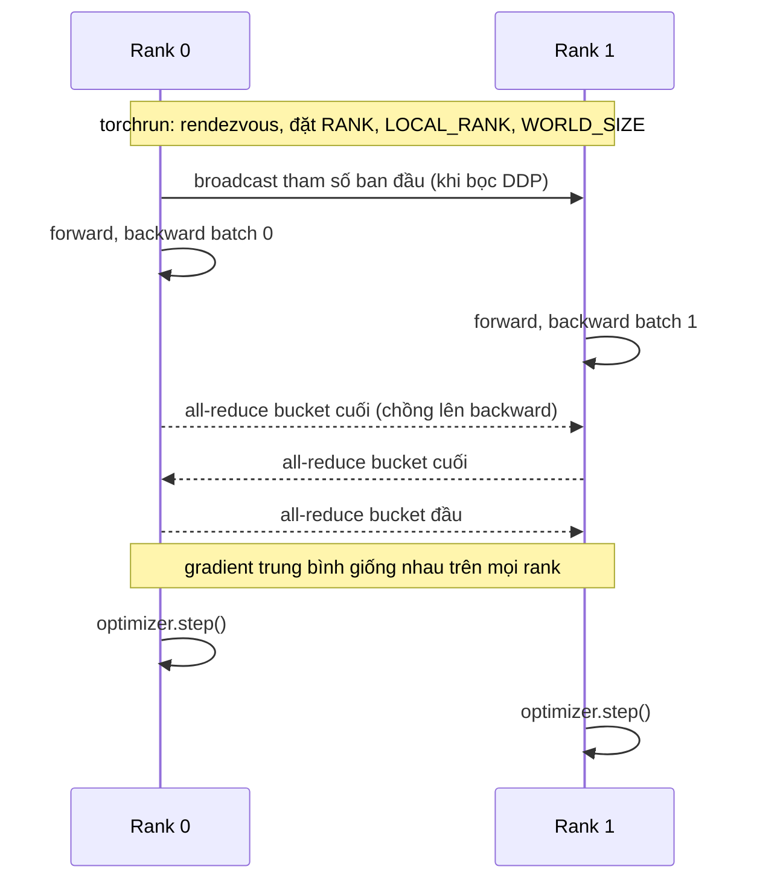
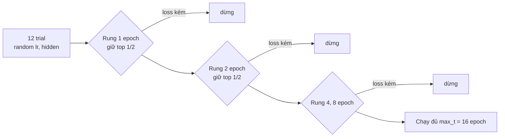
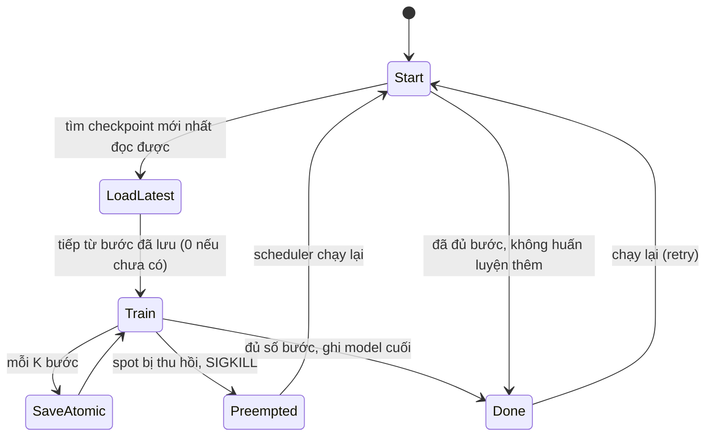

# Distributed training và GPU compute

Đến module 14, model của service ETA huấn luyện trên một máy trong vài phút. Khi dữ liệu lớn gấp trăm lần hoặc model có hàng tỉ
tham số, một GPU không đủ thời gian hoặc không đủ bộ nhớ, và việc của MLOps chuyển sang chỗ khác: chạy nhiều tiến trình cùng huấn
luyện một model, chia model ra nhiều GPU, chịu được việc một máy bị thu hồi giữa chừng, giữ cho GPU đắt tiền không ngồi chờ dữ liệu, và
trả lời câu "job này tốn bao nhiêu tiền" trước khi bấm chạy.

Module này dạy các ý đó bằng thứ chạy được trên laptop: nhiều tiến trình CPU nói chuyện qua backend **gloo** thay cho nhiều GPU nói
chuyện qua NCCL. Cơ chế (rendezvous, all-reduce, shard tham số, checkpoint, dừng sớm trial) giống hệt; chỉ tốc độ và băng thông khác.
Bạn sẽ đo được DDP giữ nguyên bản model trên mỗi rank còn FSDP chỉ giữ một nửa, kill một job đang chạy rồi chạy lại và nhận kết quả
giống hệt chạy liền, và chạy Ray Tune với scheduler ASHA dừng sớm trial kém.

Nói thẳng: đây là **kiến thức tầng senior**, không thay được kinh nghiệm vận hành job trên cụm GPU thật. Multi-GPU, NVLink, InfiniBand,
MIG và nhiều node thật chỉ ở mức khái niệm, đo và mô phỏng. Lần đầu bạn gặp một job 64 GPU treo lúc 3 giờ sáng sẽ dạy bạn những thứ
không bài tập nào dạy được; module này cho bạn khung để đọc tình huống đó và biết bắt đầu từ đâu.

## 0. Cài đặt

Môi trường mặc định (`uv sync`) đã đủ cho mọi bài: `torch` bản CPU có sẵn backend gloo và FSDP2, `ray[train,tune]` nằm trong group
`mlops-senior` (thuộc `default-groups` nên `uv sync` cài luôn). Không cần GPU, Docker hay cluster kind.

| Gói | Phiên bản đã kiểm | Ghi chú |
| --- | --- | --- |
| `torch` | 2.14.1 (`+cpu`) | `torch.distributed` (gloo), `torch.distributed.run` (torchrun), `fully_shard` (FSDP2) |
| `ray[train,tune]` | 2.59.0 | Ray Core, Ray Train, Ray Tune; group `mlops-senior` |

Kiểm:

```bash
uv sync --frozen
uv run python -c "import torch, torch.distributed as d, ray; print(torch.__version__, d.is_gloo_available(), ray.__version__)"
```

Gỡ Ray (giữ phần còn lại): `uv sync --frozen --no-group mlops-senior`. Bài Ray Tune sẽ fail khi import cho tới khi `uv sync` lại.

**Chạy torchrun trên máy học.** Mọi bài và test dùng cùng một lệnh:

```bash
uv run python -m torch.distributed.run --nproc_per_node=2 \
  --rdzv-backend=c10d --rdzv-endpoint=127.0.0.1:0 --local-addr=127.0.0.1 \
  script.py --out /tmp/mlops-15/x
```

- `--rdzv-endpoint=127.0.0.1:0`: hệ điều hành chọn cổng trống, nên nhiều job (hoặc nhiều người) chạy song song không giành cổng 29500.
- `--local-addr=127.0.0.1`: không có cờ này, rendezvous quảng bá hostname của máy; trên máy có hostname phân giải ra IP LAN không định
  tuyến được (vd. `DESKTOP.lan`), worker không kết nối được và job **treo** ở bước rendezvous. Vì vậy cũng không dùng `--standalone`
  (nó là `c10d` trên `localhost:0` nhưng không có `--local-addr`).
- Đặt `OMP_NUM_THREADS=1` (script trong bài đã gọi `torch.set_num_threads(1)`) để hai rank không giành nhau mọi core, và
  `GLOO_SOCKET_IFNAME=lo` để gloo chỉ nghe loopback.

Test chạy lệnh này qua helper `distkit.py` của module: mỗi lần chạy có **timeout cứng**, output ghi tệp, và khi xong hay hết giờ thì
diệt mọi tiến trình của lần chạy. Lý do cần helper: `torchrun` đặt mỗi worker vào một session riêng, nên giết `torchrun` (kể cả
`kill -9`) **không** giết worker đang treo trong collective; worker mồ côi giữ cổng và CPU tới khi hết timeout của gloo (30 phút). Tự
chạy tay mà job treo thì `Ctrl-C` một lần, chờ vài giây, rồi `pkill -f script.py` nếu còn tiến trình.

**Chạy Ray.** Tự chạy script Ray bằng `uv run` thì đặt hai biến (test đặt sẵn qua `mlopskit.ray_local`):

```bash
export RAY_ENABLE_UV_RUN_RUNTIME_ENV=0      # không có: worker Ray chạy lại `uv run` trong bản sao thư mục, trial treo PENDING
export RAY_ENABLE_WINDOWS_OR_OSX_CLUSTER=0  # cùng ray.init(_node_ip_address="127.0.0.1"): mọi cổng Ray chỉ ở loopback
uv run python tracks/mlops/modules/15-distributed-training/solutions/intermediate/02-ray-tune-asha/tune_search.py
```

Không chạy Ray với IP LAN trên máy học: GCS và raylet mở gRPC không xác thực ra mạng.

## 1. Vì sao phân tán và ba cách chia việc

Hai lý do khiến một GPU không đủ: **thời gian** (một epoch trên 1 TB ảnh mất cả ngày) và **bộ nhớ** (model 7 tỉ tham số không vừa một
GPU 80 GB khi huấn luyện, mục 3). Ba cách chia việc trả lời hai lý do đó khác nhau:

| Cách | Chia gì | Mỗi worker giữ | Giao tiếp | Dùng khi |
| --- | --- | --- | --- | --- |
| Data parallel (DDP) | dữ liệu: mỗi rank một phần batch | toàn bộ model | all-reduce gradient mỗi bước | model vừa một GPU, cần nhanh hơn |
| Sharded data parallel (FSDP, ZeRO) | dữ liệu, và **trạng thái** model chia đều | 1/N tham số, gradient, optimizer state | all-gather tham số, reduce-scatter gradient | model không vừa khi huấn luyện, vẫn muốn code như data parallel |
| Tensor parallel (Megatron) | từng ma trận trong một layer | một lát của mỗi layer | all-reduce activation trong **mỗi** layer | layer quá to; cần NVLink, thường trong một node |
| Pipeline parallel (GPipe, 1F1B) | các layer liên tiếp thành stage | vài layer | gửi activation giữa stage | model rất sâu, nhiều node; chịu "bong bóng" chờ |

Tensor và pipeline parallel thường gọi chung là **model parallel**. Các mô hình rất lớn kết hợp cả ba (3D parallelism): tensor parallel
trong node, pipeline giữa node, data parallel trên cùng. Với pipeline, chia batch thành $$m$$ micro-batch qua $$p$$ stage thì tỉ lệ thời
gian chờ (bubble) là $$\frac{p-1}{m+p-1}$$: 4 stage với 4 micro-batch phí 43%, với 32 micro-batch còn 9%.



Quy tắc chọn thực tế: model vừa một GPU thì **DDP** (đơn giản nhất, nhanh nhất). Không vừa thì **FSDP** trước (đổi vài dòng code). Chỉ
khi FSDP không đủ (layer quá to, hàng trăm GPU) mới cần tensor/pipeline parallel, và khi đó dùng framework làm sẵn (Megatron-LM,
DeepSpeed, TorchTitan) thay vì tự viết.

## 2. DDP từ bên trong: all-reduce, bucket và torchrun

**DDP** (`DistributedDataParallel`) giữ một bản sao model trên mỗi rank. Khi bọc model, DDP broadcast tham số và buffer từ rank 0 sang
mọi rank để chắc chắn mọi bản sao bắt đầu giống nhau. Mỗi bước, từng rank forward và backward trên batch riêng; gradient được
**all-reduce** (cộng trên mọi rank rồi chia cho số rank) nên sau `optimizer.step()` mọi rank có tham số giống hệt, giống như huấn luyện
một tiến trình trên batch toàn cục (bài Basic 01 kiểm đúng điều này bằng cách so với huấn luyện một tiến trình).

Hai chi tiết làm DDP nhanh:

- **Gradient bucket.** DDP gom gradient thành các bucket (mặc định khoảng 25 MB, `bucket_cap_mb`) theo thứ tự ngược với forward. Bucket
  nào đủ gradient thì all-reduce ngay **trong lúc** backward còn tính các layer phía trước: giao tiếp chồng lên tính toán.
- **Ring all-reduce.** Mỗi rank gửi và nhận khoảng $$2\frac{N-1}{N}$$ lần kích thước gradient, gần như không đổi khi $$N$$ tăng. Băng
  thông giữa GPU (NVLink trong node, InfiniBand giữa node) quyết định hiệu suất scale.



Mỗi rank phải thấy **dữ liệu khác nhau**: `DistributedSampler` chia chỉ số mẫu theo rank, và `sampler.set_epoch(epoch)` đổi thứ tự xáo
mỗi epoch (quên gọi thì mọi epoch lặp lại đúng một thứ tự). Batch toàn cục là `batch_per_rank x world_size`; tăng số rank mà giữ
learning rate cũ là đổi bài toán, thường cần scale LR theo (linear scaling kèm warmup).

**torchrun** (`python -m torch.distributed.run`) khởi chạy `--nproc_per_node` tiến trình mỗi node và làm **rendezvous**: các worker tìm
nhau qua một store (TCPStore) rồi nhận `RANK` (toàn cục), `LOCAL_RANK` (trong node, dùng để chọn GPU `cuda:LOCAL_RANK`), `WORLD_SIZE`,
`MASTER_ADDR`, `MASTER_PORT`. Script chỉ cần `dist.init_process_group(backend)` không tham số; mọi thứ khác đọc từ biến môi trường.

| Rendezvous | Cờ | Đặc điểm |
| --- | --- | --- |
| static | `--master-addr`, `--master-port`, `--nnodes=N` | số node cố định; thiếu một node thì cả job chờ |
| c10d (elastic) | `--rdzv-backend=c10d --rdzv-endpoint=host:port --nnodes=MIN:MAX` | chấp nhận số node thay đổi trong khoảng; worker hỏng thì torchrun khởi động lại **cả nhóm** (`--max-restarts`) |

Elastic không có nghĩa là "worker chết thì job chạy tiếp như không có gì": torchrun dừng mọi worker và chạy lại script từ đầu. Script
phải tự **resume từ checkpoint** (mục 5); không có checkpoint thì elastic chỉ là chạy lại từ đầu tự động.

**Backend.** `nccl` cho GPU NVIDIA (nhanh, dùng NVLink/InfiniBand); `gloo` cho CPU (và GPU khi không có NCCL, chậm); `mpi` khi cụm HPC có
sẵn MPI. Code giống nhau, chỉ đổi tên backend và thiết bị của tensor.

**Khi job nhiều tiến trình treo.** Collective (all-reduce, broadcast, barrier...) là điểm hẹn: một rank gọi thì đứng chờ mọi rank khác
gọi **đúng collective tương ứng**. Treo không in lỗi; job đứng yên tới khi hết timeout của process group (mặc định 30 phút với gloo,
10 phút với NCCL). Cách điều tra:

1. Rank nào đang ở đâu: log từng rank (bước cuối cùng ghi được), `py-spy dump --pid <pid>` cho từng worker xem stack Python.
2. `TORCH_DISTRIBUTED_DEBUG=DETAIL` ghi và kiểm thứ tự collective của từng rank; `TORCH_CPP_LOG_LEVEL=INFO` cho log rendezvous.
3. Đặt `timeout=` ngắn trong `init_process_group` khi debug để treo biến thành lỗi có stack.
4. Nguyên nhân hay gặp: rendezvous chờ rank không bao giờ tới (sai `--nnodes`, sai địa chỉ, firewall), các rank đi vào nhánh code
   khác nhau, dữ liệu chia không đều làm một rank hết batch trước, một rank chết mà rank khác không biết, DataLoader worker kẹt.

Bài sự cố Intermediate 04 là một job như vậy.

## 3. Bộ nhớ khi huấn luyện: ZeRO, FSDP và DeepSpeed

Huấn luyện mixed precision với Adam, mỗi tham số tốn khoảng **16 byte** cho "trạng thái model" (theo bài báo ZeRO): 2 byte tham số
fp16/bf16, 2 byte gradient, 4 byte bản fp32 của tham số, 4 + 4 byte hai moment của Adam. Model 7B cần $$7 \times 10^9 \times 16 =
112$$ GB **trước khi** tính activation, quá một GPU H100 80 GB. Inference cùng model chỉ cần 14 GB (bf16), đó là lý do model "chạy được"
trên một GPU vẫn không "huấn luyện được" trên GPU đó.

**ZeRO** (Zero Redundancy Optimizer, DeepSpeed) bỏ sự trùng lặp của DDP theo ba mức, với $$N$$ GPU:

| Mức | Chia đều cho $$N$$ GPU | Bộ nhớ trạng thái mỗi GPU (byte/tham số) | Giao tiếp so với DDP |
| --- | --- | --- | --- |
| DDP | không gì | 16 | 1x |
| ZeRO-1 | optimizer state (fp32 + Adam) | $$4 + 12/N$$ | 1x |
| ZeRO-2 | + gradient | $$2 + 14/N$$ | 1x |
| ZeRO-3 / FSDP full shard | + tham số | $$16/N$$ | khoảng 1.5x |

Với 7B trên 8 GPU: ZeRO-3 cần 14 GB trạng thái mỗi GPU, còn chỗ cho activation. Giá phải trả của ZeRO-3: trước forward (và lại trước
backward) của mỗi khối, các rank **all-gather** tham số của khối đó, dùng xong thì bỏ; gradient đi qua **reduce-scatter** để mỗi rank
chỉ giữ phần gradient của mình.

**FSDP** là bản ZeRO-3 của PyTorch. FSDP2 (`torch.distributed.fsdp.fully_shard`) chia **từng tham số** theo chiều 0 thành `DTensor`;
gọi `fully_shard` cho từng khối (mỗi transformer block) rồi cho model gốc để mỗi khối là một đơn vị all-gather. Chú ý khi đo:
`DTensor.numel()` trả kích thước **toàn cục**; phần thật sự nằm trên rank là `tensor.to_local()`. Bài Intermediate 01 đo đúng điều đó: DDP
giữ 100% trên mỗi rank, FSDP giữ khoảng 50% trên mỗi rank với 2 rank, tổng hai rank bằng kích thước model, và loss từng bước giống DDP.
`reshard_after_forward=False` giữ tham số sau forward (gần ZeRO-2: ít giao tiếp hơn, tốn bộ nhớ hơn). Checkpoint của model đã shard dùng
`torch.distributed.checkpoint` (mỗi rank ghi phần của mình) thay vì `torch.save` một tệp.

Các đòn bẩy bộ nhớ khác: **activation checkpointing** (không lưu activation, tính lại khi backward: thêm khoảng 30% tính toán để đổi lấy
bộ nhớ activation), **mixed precision** bf16, **gradient accumulation** (batch lớn bằng nhiều micro-batch), **CPU/NVMe offload**
(ZeRO-Offload, ZeRO-Infinity: đẩy optimizer state ra RAM/đĩa, chậm nhưng vừa).

| Công cụ | Là gì | Điểm mạnh | Điểm yếu |
| --- | --- | --- | --- |
| PyTorch DDP/FSDP2 | có sẵn trong PyTorch | không thêm dependency, hệ sinh thái (TorchTitan, torchtune) dùng trực tiếp | ít tính năng offload hơn DeepSpeed |
| DeepSpeed | thư viện của Microsoft, cấu hình bằng JSON | ZeRO 1/2/3, offload CPU/NVMe, pipeline, nhiều tối ưu kernel | thêm một lớp trừu tượng và config; debug khó hơn |
| Horovod | ring all-reduce trên MPI/NCCL cho TF, PyTorch, MXNet | độc lập framework, hợp cụm HPC có MPI | chỉ data parallel, không shard; ít được phát triển từ khi PyTorch có DDP |
| Megatron-LM | tensor + pipeline parallel cho transformer | scale tới hàng nghìn GPU | gắn với kiến trúc transformer, khó dùng cho model khác |

Hugging Face Accelerate và Lightning là lớp bọc chọn DDP/FSDP/DeepSpeed bằng cấu hình; chúng không thay đổi cơ chế bên dưới.

## 4. Ray: task, actor, Ray Train và Ray Tune

**Ray Core** là runtime phân tán cho Python. **Task** (`@ray.remote` trên hàm) là phép tính không trạng thái chạy ở worker nào đó;
**actor** (`@ray.remote` trên lớp) là một tiến trình giữ trạng thái, gọi phương thức từ xa. Kết quả là `ObjectRef`, dữ liệu lớn nằm
trong object store dùng chung bộ nhớ trên mỗi node. Scheduler của Ray đặt task/actor theo tài nguyên khai báo (`num_cpus`, `num_gpus`,
tài nguyên tự đặt).

```python
@ray.remote(num_cpus=1)
def score(shard): ...

@ray.remote
class Counter:
    def __init__(self): self.n = 0
    def add(self, k): self.n += k; return self.n

refs = [score.remote(s) for s in shards]
results = ray.get(refs)
```

**Ray Train** dựng nhóm worker DDP cho bạn: `TorchTrainer(train_loop, scaling_config=ScalingConfig(num_workers=4, use_gpu=True))`
khởi tạo process group, `prepare_model` bọc DDP (hoặc FSDP), `prepare_data_loader` thêm `DistributedSampler`. Khác torchrun ở chỗ nhóm
worker là actor Ray: cùng cụm Ray có thể chạy Ray Data (đọc và tiền xử lý song song), Ray Tune và Ray Serve. Chịu lỗi bằng
`RunConfig(failure_config=FailureConfig(max_failures=3))` cộng với `ray.train.report(metrics, checkpoint=...)`: worker chết thì Ray dựng
lại nhóm và gọi lại vòng huấn luyện, vòng huấn luyện đọc `ray.train.get_checkpoint()` để tiếp. Với Ray 2.59 (Train V2, đã kiểm), metric
trong `Result` gắn với checkpoint: báo metric không kèm checkpoint thì `result.metrics` là `None`.

**Ray Tune** chạy nhiều **trial** (một bộ siêu tham số) song song theo tài nguyên. Hai thành phần độc lập:

- **Search algorithm** chọn config tiếp theo: random/grid (`BasicVariantGenerator`, mặc định), Bayesian (Optuna, HyperOpt).
- **Scheduler** quyết định dừng sớm trial nào: FIFO (không dừng), **ASHA**, PBT (đổi siêu tham số giữa chừng).

**ASHA** (Asynchronous Successive Halving) đặt các mốc (rung) tại `grace_period x reduction_factor^k` vòng lặp. Trial tới một rung mà
metric không nằm trong top `1/reduction_factor` của những trial đã tới rung đó thì bị dừng. "Asynchronous" nghĩa là không chờ cả đợt
trial cùng tới rung: trial nào tới thì so với những trial đã tới trước, nên GPU không ngồi không. Trial chạy sớm có lợi (so với ít đối
thủ hơn) và ASHA chấp nhận điều đó để đổi lấy tốc độ.



Tune ghi kết quả vào `RunConfig(storage_path=...)` (mặc định `~/ray_results`); đặt đường dẫn rõ ràng (hoặc S3) để job khác đọc lại và để
không làm đầy home. Với `num_cpus=2` và mặc định 1 CPU mỗi trial, hai trial chạy cùng lúc (bài Intermediate 02).

## 5. Checkpoint và resume khi bị preempt

GPU spot/preemptible rẻ hơn on-demand 60-70% nhưng bị thu hồi với cảnh báo ngắn (AWS 2 phút, GCP 30 giây), và job dài hàng ngày trên
hàng chục GPU gần như chắc chắn gặp ít nhất một lần hỏng phần cứng. Job huấn luyện vì thế phải **chạy lại được bất kỳ lúc nào** và
cho cùng kết quả.

Checkpoint đủ để tiếp tục phải có: tham số model, **optimizer state** (thiếu nó, Adam bắt đầu lại moment từ 0: loss nhảy và kết quả lệch),
LR scheduler, số bước đã xong, trạng thái sinh số ngẫu nhiên, vị trí trong dữ liệu (epoch của sampler và vị trí trong epoch), GradScaler
nếu dùng fp16. Cách dễ nhất cho phần dữ liệu là làm thứ tự batch là **hàm của số bước** (seed + epoch), không phụ thuộc trạng thái đã chạy.

Ghi checkpoint đúng cách:

- **Nguyên tử**: ghi vào tệp tạm cùng thư mục, `fsync`, rồi `os.replace` sang tên thật. Bị kill giữa lúc ghi thì tên thật hoặc là bản cũ,
  hoặc là bản mới đầy đủ, không bao giờ là nửa tệp. Object storage (S3) thì upload xong mới ghi tệp "manifest" trỏ tới.
- **Một rank ghi** (với DDP mọi rank giống nhau) rồi `barrier`; với FSDP mỗi rank ghi phần shard của mình qua
  `torch.distributed.checkpoint`.
- **Khi khởi động**: tìm checkpoint mới nhất **đọc được**, bỏ qua tệp hỏng, nạp vào **mọi** rank.
- **Idempotent**: chạy lại job đã xong không huấn luyện thêm và không đổi kết quả; scheduler (Kubernetes Job, Argo, Ray) cứ việc
  retry mà không sợ.
- Bắt `SIGTERM` (thông báo thu hồi) để ghi một checkpoint cuối nếu kịp; đừng chỉ dựa vào nó.



Checkpoint dày thì tốn thời gian ghi, thưa thì mất nhiều việc mỗi lần bị thu hồi (trung bình mất nửa khoảng checkpoint, cộng thời gian
khởi động lại). Công thức Young cho khoảng tối ưu: $$\tau = \sqrt{2 \delta M}$$, với $$\delta$$ là thời gian ghi một checkpoint và
$$M$$ là thời gian trung bình giữa hai lần bị thu hồi. Ghi mất 3 phút, trung bình 50 giờ bị thu hồi một lần: $$\tau \approx 2.2$$ giờ.
Bài Basic 02 kill thật job đang chạy, cấy một checkpoint hỏng, chạy lại và so kết quả với chạy liền; Basic 03 tính chi phí của khoảng
checkpoint.

## 6. Throughput nạp dữ liệu: GPU không được ngồi chờ

Một bước trên GPU mất 20 ms nhưng đọc và giải mã một batch ảnh mất 80 ms thì GPU rảnh 80% thời gian, dù `nvidia-smi` vẫn hiện tiến
trình đang chạy. Dấu hiệu: GPU utilization thấp và răng cưa, thời gian mỗi bước dao động, tăng batch hay đổi GPU nhanh hơn không làm
job nhanh hơn.

Đo trước khi sửa: trong vòng huấn luyện, tách **thời gian chờ batch tiếp theo** (`next(iterator)`) khỏi **thời gian bước huấn luyện**,
bỏ vài batch đầu (worker đang khởi động). Tỉ lệ chờ lớn (vd. trên 20%) là nghẽn ở dữ liệu; nhỏ là nghẽn ở tính toán. Với GPU thật,
bước huấn luyện chạy bất đồng bộ: gọi `torch.cuda.synchronize()` trước khi bấm giờ, nếu không thời gian chờ dữ liệu bị tính lẫn.

| Đòn bẩy | Tác dụng | Lưu ý |
| --- | --- | --- |
| `num_workers` | nhiều tiến trình đọc/giải mã song song | mỗi worker một bản dataset; tổng `num_workers x số rank` không vượt số core |
| `prefetch_factor` | mỗi worker chuẩn bị trước bấy nhiêu batch | tốn RAM; không cứu được khi worker chậm hơn GPU về trung bình |
| `persistent_workers=True` | không dựng lại worker mỗi epoch | epoch ngắn thì khởi động worker chiếm phần lớn |
| `pin_memory=True` | copy host sang GPU nhanh, chồng lên tính toán | chỉ có ích với GPU |
| Định dạng dữ liệu | shard lớn (WebDataset, Parquet, TFRecord) thay vì triệu tệp nhỏ | đọc tuần tự từ S3 nhanh hơn nhiều lần đọc ngẫu nhiên |
| Giải mã trên GPU, cache | NVIDIA DALI, giải mã một lần rồi cache tensor | khi CPU là giới hạn cứng |

Chọn số worker nhỏ nhất làm hết nghẽn dữ liệu, không phải số lớn nhất có thể: mỗi worker tốn RAM và core mà rank khác (hoặc job khác
trên cùng node) cũng cần. Bài Intermediate 03 đo tỉ lệ chờ theo `num_workers` và chọn số đủ dùng.

## 7. Chi phí GPU và kế hoạch scale

Ba con số cho mọi ước tính:

- **Giờ GPU của một GPU** cho cả job (đo vài trăm bước rồi nhân lên).
- **Hiệu suất scale** $$e = \frac{T_N}{N \cdot T_1}$$ với $$T$$ là thông lượng (mẫu/giây). 8 GPU nhanh 7 lần thì $$e = 0.875$$. Giao tiếp,
  đồng bộ và phần tuần tự (định luật Amdahl) làm $$e$$ giảm khi $$N$$ tăng, giảm nhanh khi đi qua mạng giữa node chậm.
- **Giá mỗi giờ GPU** theo loại GPU và thị trường (on-demand, spot, cam kết dài hạn).

Thời gian đồng hồ là $$\frac{H_1}{N e}$$, giờ GPU phải trả là $$\frac{H_1}{e}$$: thêm GPU làm xong sớm hơn nhưng **không rẻ hơn**, và đắt hơn khi
$$e$$ giảm. Spot rẻ nhưng cộng thêm phần làm lại sau mỗi lần thu hồi (mục 5). GPU nhanh hơn có giá giờ cao hơn nhưng có thể rẻ hơn tính
trên cả job. Bài Basic 03 đọc bảng giá YAML (số minh hoạ có ngày) và chọn phương án rẻ nhất kịp deadline.

GPU trên cụm dùng chung (mức khái niệm, không có lab GPU nhiều card trong module này):

- **MIG** (A100, H100): chia một GPU thành tối đa 7 instance có bộ nhớ và SM riêng, cách ly thật; hợp inference nhỏ và notebook, không
  hợp huấn luyện lớn.
- **Time-slicing**: nhiều pod chia lượt một GPU, không cách ly bộ nhớ.
- **Topology**: 8 GPU trong một node nối NVLink nhanh hơn nhiều so với 8 GPU ở 8 node qua Ethernet; job DDP/FSDP lớn cần InfiniBand
  hoặc RoCE giữa node. Lập lịch theo nhóm (gang scheduling, Kueue ở module 14) để không có job nửa số GPU ngồi chờ nửa còn lại.

Kế hoạch scale tốt bắt đầu nhỏ: chạy 1 GPU đo thông lượng và bộ nhớ, rồi 2, 4, 8 GPU trong một node để đo $$e$$, kiểm resume từ
checkpoint **trước** khi thuê 64 GPU spot. Hai bài Advanced viết kế hoạch đó cho 8 GPU spot và chọn chiến lược cho model 7B.

## 8. Tài liệu tham khảo

- PyTorch: [Getting started with DDP](https://docs.pytorch.org/tutorials/intermediate/ddp_tutorial.html),
  [torchrun (Elastic Launch)](https://docs.pytorch.org/docs/stable/elastic/run.html),
  [FSDP2 `fully_shard`](https://docs.pytorch.org/docs/stable/distributed.fsdp.fully_shard.html),
  [Distributed checkpoint](https://docs.pytorch.org/docs/stable/distributed.checkpoint.html),
  [DataLoader](https://docs.pytorch.org/docs/stable/data.html).
- Li và cộng sự, "PyTorch Distributed: Experiences on Accelerating Data Parallel Training" (VLDB 2020): gradient bucket và chồng giao tiếp.
- Rajbhandari và cộng sự, "ZeRO: Memory Optimizations Toward Training Trillion Parameter Models" (SC 2020).
- Zhao và cộng sự, "PyTorch FSDP: Experiences on Scaling Fully Sharded Data Parallel" (VLDB 2023).
- Shoeybi và cộng sự, "Megatron-LM" (2019); Huang và cộng sự, "GPipe" (2019): tensor và pipeline parallel.
- [DeepSpeed ZeRO](https://www.deepspeed.ai/tutorials/zero/), [Horovod](https://horovod.readthedocs.io/).
- Ray: [Ray Core key concepts](https://docs.ray.io/en/latest/ray-core/key-concepts.html),
  [Ray Train PyTorch](https://docs.ray.io/en/latest/train/getting-started-pytorch.html),
  [Ray Tune schedulers (ASHA)](https://docs.ray.io/en/latest/tune/api/schedulers.html).
- Li và cộng sự, "A System for Massively Parallel Hyperparameter Tuning" (MLSys 2020): ASHA.
- Young, "A first order approximation to the optimum checkpoint interval" (CACM 1974).
- Hugging Face, [The Ultra-Scale Playbook](https://huggingface.co/spaces/nanotron/ultrascale-playbook): huấn luyện LLM trên cụm GPU lớn.
