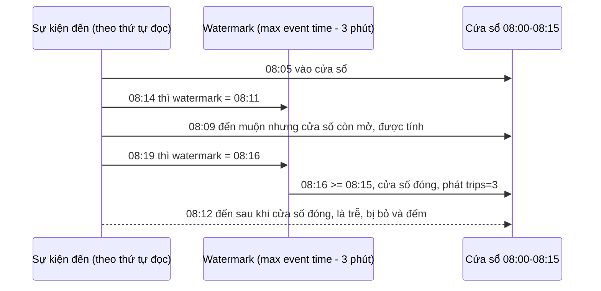
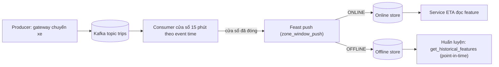
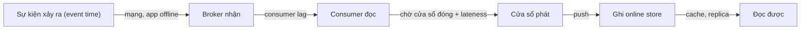
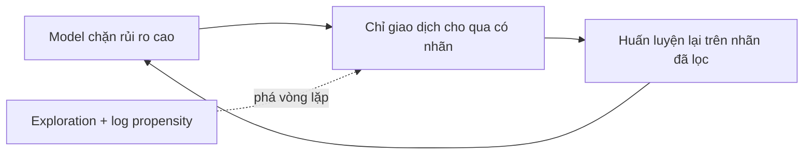

# Streaming feature và real-time ML

Tới module 15, feature của service ETA được tính theo lô và materialize vào online store theo lịch: feature "số chuyến 15 phút
qua của zone" có thể cũ cả giờ. Module này làm feature từ stream: đọc sự kiện từ Kafka, gộp theo cửa sổ thời gian **theo lúc sự kiện
xảy ra**, đẩy thẳng vào online store bằng Feast push, và đo xem feature tươi đến đâu. Sau đó là hai câu hỏi mà phỏng vấn senior hay
hỏi: có nên để model tự học liên tục trên stream (online learning với River) không, và chuyện gì xảy ra khi chính quyết định của model
làm lệch dữ liệu nó học lại (feedback loop).

Nói thẳng: đây là tầng senior, là **kiến thức**, không thay được kinh nghiệm vận hành một pipeline streaming production. Các bài chạy
trên một broker Kafka một node, một partition, vài nghìn sự kiện phát lại từ chuyến taxi NYC thật; chúng cho bạn đúng các khái niệm
(event time, watermark, freshness, skew) và một sự cố tái hiện được, nhưng không cho bạn cảm giác một consumer group 200 partition
rebalance lúc đỉnh tải. Khi gặp thật, khung ở đây giúp bạn biết nhìn vào đâu trước.

## 0. Cài đặt

Cần Docker và stack MLOps (module 02). Kafka nằm trong profile `streaming` của `setup/mlops/compose.yaml`: một broker chế độ KRaft
(không ZooKeeper), tắt tự tạo topic, không volume (xoá container là mất topic). Client Python `kafka-python-ng` và `river` đã có trong
môi trường `uv` của repo. Feast chạy trong container `mlops-feast:0.67.0` như module 06, build lần đầu khi test cần.

| Thành phần | Phiên bản đã kiểm | Ở đâu |
| --- | --- | --- |
| Kafka broker | `apache/kafka:4.3.1` (ghim digest) | service `kafka`, profile `streaming`, cổng máy `127.0.0.1:29092` (`MLOPS_KAFKA_PORT`), trong mạng compose `kafka:9092` |
| kafka-python-ng | 2.2.3 | `pyproject.toml` của repo |
| River | 0.26.1 | `pyproject.toml` của repo |
| Feast | 0.67.0 | image `mlops-feast:0.67.0` (`setup/mlops/feast/`) |
| Dữ liệu | TLC yellow taxi 2019-03 (kiểm sha256) | `uv run python data/download_dataset.py nyc-tlc` |

Bật, kiểm, gỡ:

```bash
docker compose -f setup/mlops/compose.yaml --profile streaming up -d --wait kafka
docker compose -f setup/mlops/compose.yaml --profile streaming exec kafka /opt/kafka/bin/kafka-topics.sh --bootstrap-server kafka:9092 --list
docker compose -f setup/mlops/compose.yaml --profile streaming stop kafka
docker compose -f setup/mlops/compose.yaml --profile streaming rm -f kafka
```

Test tạo topic tạm `mlops-ex-<uuid8>` qua `mlopskit.kafka_topic()` và xoá khi xong, kể cả khi lỗi; Kafka chưa bật thì test skip kèm
lệnh bật profile. Tự thử bằng tay thì đặt tên topic của riêng bạn và xoá khi xong; đừng xoá topic người khác đang dùng.

## 1. Ôn nhanh Kafka (từ DE 07)

Kafka đã được dạy kỹ ở [Data Engineer module 07](../../../data-engineer/modules/07-streaming-kafka/README.md) (mục 2–4: broker, topic,
partition, offset, consumer group, delivery semantics; mục 6: event time, windowing, watermark). Ở đây chỉ nhắc những điểm feature
realtime phụ thuộc vào:

- **Thứ tự chỉ được bảo đảm trong một partition.** Key theo thực thể của feature (zone, thẻ) để mọi sự kiện của một thực thể vào cùng
  partition. Key lệch (một merchant khổng lồ) tạo partition nóng.
- **Song song tối đa bằng số partition.** Thêm consumer quá số partition thì consumer thừa ngồi chơi.
- **Offset là con trỏ đọc, commit là lời hứa "đã xử lý xong tới đây".** At-least-once (commit sau khi ghi feature) cộng ghi idempotent
  là cấu hình phổ biến nhất cho feature; exactly-once thật cần transaction của Kafka hoặc engine có checkpoint.
- **Consumer lag** là số message chưa đọc; với feature, lag tính theo **thời gian** mới là thứ ảnh hưởng tới model (bài Advanced 02).

## 2. Event time, cửa sổ và watermark

Một chuyến taxi có ba thời điểm: lúc đón khách (**event time**), lúc broker nhận (ingestion time), lúc consumer xử lý (**processing
time**). Mạng chập chờn, app offline, consumer restart làm sự kiện đến muộn và lệch thứ tự. Feature "số chuyến 15 phút qua" tính theo
processing time sẽ đổi theo lần chạy: consumer chết 20 phút rồi đọc dồn thì cửa sổ lúc đọc lại phình to, các cửa sổ lúc chết thì rỗng.
Tính theo event time thì kết quả xác định, nhưng phải trả lời: chờ sự kiện muộn bao lâu?

| Cửa sổ | Định nghĩa | Feature ví dụ |
| --- | --- | --- |
| Tumbling | dài cố định, không gối nhau, `start = ts - ts % size` | số chuyến mỗi 15 phút của zone |
| Sliding (hopping) | dài `size`, trượt `step < size`, một sự kiện vào `size / step` cửa sổ | số giao dịch của thẻ trong 10 phút gần nhất, cập nhật mỗi phút |
| Session | gộp sự kiện cách nhau dưới `gap`, dài thay đổi | số trang xem trong một phiên |

**Watermark** là lời hứa của hệ thống: "sự kiện có event time cũ hơn mức này coi như đã đến hết". Heuristic phổ biến nhất (bounded
out-of-orderness): `watermark = max(event time đã thấy) - lateness`. Cửa sổ đóng và phát kết quả khi `window_end <= watermark`; sự kiện
đến sau khi cửa sổ của nó đã đóng là **trễ**: bỏ, đếm, hoặc đưa ra side output để backfill offline. `lateness` là núm vặn giữa đúng và
nhanh: lớn thì ít bỏ sự kiện nhưng feature có muộn đúng chừng đó.



Hai chi tiết hay bị bỏ qua:

- **Trùng lặp.** Producer retry, consumer at-least-once làm một sự kiện đến hai lần. Gắn `event_id` ở nguồn và chống trùng **trước**
  khi xét trễ (bản gửi lại của sự kiện trễ phải được đếm là trùng). Trạng thái chống trùng phải có hạn (theo thời gian), nếu không nó
  lớn mãi.
- **Watermark chỉ tăng.** Một sự kiện duy nhất có event time ở tương lai (đồng hồ thiết bị sai, timestamp mili giây bị hiểu là giây,
  múi giờ parse sai) kéo watermark vọt lên, và mọi sự kiện đúng giờ sau đó bị coi là trễ. Phòng vệ: so event time với ingestion time và
  loại sự kiện "đến từ tương lai"; cảnh báo khi độ trễ của watermark so với đồng hồ thật bất thường. Bài Intermediate 03 là một sự cố kiểu
  này.

Nhiều partition thì mỗi partition có watermark riêng và watermark của job là **nhỏ nhất**; một partition rảnh không có sự kiện giữ cả job
đứng yên (Flink có `withIdleness`). Bài Basic 01 cài đặt toàn bộ logic trên bằng Python thuần; Intermediate 01 đặt nó lên topic thật.

## 3. Feature realtime vào Feast bằng push

Module 06 materialize feature từ offline store vào online store theo lịch. Với feature stream, đường đó quá chậm: Feast có **push
source**, cho phép job stream ghi thẳng một DataFrame vào online store (`PushMode.ONLINE`), offline store (`OFFLINE`) hoặc cả hai.
FeatureView khai báo `source=PushSource(name=..., batch_source=FileSource(...))`: batch source là nơi offline lưu cùng schema, để
huấn luyện lấy được đúng những giá trị đã phục vụ.



Ba nguồn skew giữa train và serve đặc thù của feature stream:

1. **Timestamp của dòng feature.** Giá trị một cửa sổ chỉ biết đủ khi cửa sổ đóng, nên `event_timestamp = window_end`. Đặt
   `window_start` thì join point-in-time lúc 08:16 thấy tổng của 08:15–08:30, tức model học bằng thông tin tương lai mà serving không có.
2. **Ghi đè bằng giá trị cũ.** Late firing, replay, backfill gửi lại cửa sổ cũ. Online store phải giữ giá trị có `event_timestamp` lớn
   nhất. Redis online store của Feast tự kiểm việc này; SQLite thì không (ghi sau thắng), nên job phải tự bảo vệ.
3. **Kiểu dữ liệu và cách tính.** `float32` ở một phía, trung bình tính trên tập khác (có hay không bỏ trùng), cửa sổ lệch biên một giây:
   mỗi thứ đủ làm feature online khác feature huấn luyện. Cách chắc nhất là kiểm trực tiếp: giá trị online khớp tính batch trên cùng dữ
   liệu (bài Intermediate 02).

Bài Intermediate 02 dùng online store **SQLite** trong thư mục repo tạm thay cho Redis của module 06: không cần bật thêm dịch vụ, không
có trạng thái dùng chung giữa nhiều người chạy song song, và chính việc SQLite không so timestamp là một bài học.

Feature của chính request (số tiền của giao dịch đang chấm) không đi qua stream kịp: tính trong service bằng **cùng hàm** với job
offline (module 06, bài hàm feature dùng chung).

## 4. Freshness và độ trễ end-to-end: đo đúng chỗ

Freshness của một feature online là **thời gian từ lúc sự kiện xảy ra (event time) tới lúc giá trị chứa nó đọc được trong online
store**. Mỗi chặng trên đường đi cộng vào:



Đo sai chỗ là cách SLO freshness nói dối:

| Đo từ đâu tới đâu | Bỏ sót |
| --- | --- |
| consumer nhận tới push xong | mạng tới broker, lag, chờ cửa sổ, đọc được |
| `event_timestamp` của dòng tới lúc ghi | dòng cửa sổ có timestamp là `window_end`, bỏ sót phần lớn thời gian sự kiện nằm trong cửa sổ |
| event time tới lúc đọc được | đúng định nghĩa |

Trên máy kiểm, bài Intermediate 02 (cửa sổ 2 giây, lateness 1 giây) cho freshness p50 khoảng 2.1 giây, p95 khoảng 2.9 giây, trong khi đo
"nhận tới push" chỉ khoảng 0.8 giây ở p95. Với cửa sổ 15 phút, freshness tối thiểu xấp xỉ nửa cửa sổ cộng lateness: feature "15 phút qua"
về bản chất cũ trung bình hơn 7 phút. SLO freshness chặt hơn thì cần sliding window bước nhỏ, hoặc phát kết quả sớm (early firing, chế
độ update) rồi cập nhật khi cửa sổ đóng.

Báo freshness theo **phân vị** (p50, p95), đo ở phía **đọc**: service serving có thể ghi `now - event_timestamp` của feature mỗi lần
đọc, đó là SLI freshness đúng nhất (module 18, mục 1). Độ trễ end-to-end của một quyết định (request tới response) là chuyện khác:
freshness nói feature cũ bao nhiêu, latency nói trả lời nhanh bao nhiêu; service có thể nhanh mà dùng feature cũ một giờ.

## 5. Online learning với River, và khi nào không nên

Online learning cập nhật model sau từng mẫu (`learn_one`) thay vì huấn luyện lại theo lô. River là thư viện Python cho việc này:
model, scaler, bộ phát hiện drift đều có `learn_one`/`predict_one`, và đánh giá chuẩn là **prequential** (test-then-train): mỗi mẫu được
đoán trước rồi mới học, nên mỗi mẫu là dữ liệu test trước khi thành dữ liệu train.

Trên luồng có concept drift đột ngột, model online thắng rõ (bài Basic 02: khoảng 0.90 so với 0.45 của model batch đóng băng). Trên
luồng ổn định, hai bên ngang nhau và batch nhỉnh hơn. Số đó dẫn tới quyết định thực tế:

| Nên cân nhắc online learning | Không nên |
| --- | --- |
| Nhãn về gần như ngay (click, chuyển đổi trong phiên) | Nhãn về chậm (chargeback 60 ngày): "online" thực ra học từ quá khứ xa |
| Drift nhanh và liên tục (giá, xu hướng nội dung) | Drift chậm theo mùa: huấn luyện lại theo lịch rẻ và an toàn hơn |
| Model nhỏ, rủi ro mỗi quyết định thấp | Quyết định cần giải trình, kiểm toán (tín dụng, y tế) |
| Có cổng chặn dữ liệu bẩn ở đầu vào | Dữ liệu có thể bị đầu độc: mẫu xấu đi thẳng vào model đang phục vụ |

Model online khó trả lời câu "model lúc 14:02 là gì" và khó rollback. Cách dùng phổ biến ở production: model batch làm chính, model
online chạy shadow làm **chỉ báo drift**; khi online bắt đầu thắng rõ trên dữ liệu prequential, đó là tín hiệu huấn luyện lại batch.

## 6. Feedback loop: model tự làm lệch dữ liệu của nó

Model chống gian lận chặn giao dịch rủi ro; giao dịch bị chặn không bao giờ hoàn tất nên không có nhãn. Dữ liệu huấn luyện vòng sau
chỉ còn giao dịch đã được cho qua: tỉ lệ gian lận quan sát được giảm, vùng rủi ro cao gần như không có mẫu, model mới học rằng vùng đó
"an toàn". Cùng một cấu trúc ở recommendation (chỉ có click trên thứ đã hiện), tín dụng (chỉ biết nợ xấu của người được duyệt), dự báo
cảnh sát (tuần tra nhiều thì ghi nhận nhiều).

Phát hiện và sửa cần hai thứ ghi **lúc ra quyết định**:

- **Exploration**: một phần nhỏ quyết định được chọn ngẫu nhiên (cho qua 1–5% giao dịch bị chặn, chèn ngẫu nhiên vào danh sách gợi ý).
  Không có exploration thì vùng bị chặn không có thông tin, không thuật toán nào phục hồi được.
- **Propensity**: xác suất quyết định đó được chọn. Với nó, ước lượng inverse propensity weighting (IPW) `sum(y / p) / N` không chệch
  cho toàn bộ dân số; so với tỉ lệ ngây thơ trên dữ liệu có nhãn là đo được độ lệch (bài Basic 03).



Theo dõi: tỉ lệ nhãn dương theo vòng huấn luyện, độ phủ của dữ liệu theo vùng điểm, và khoảng cách giữa ước lượng ngây thơ và IPW. Off-policy
evaluation dùng chính các log này để so model mới với model cũ trước khi A/B.

## 7. Chọn engine: Flink, Spark Structured Streaming, Bytewax

Consumer tự viết trong bài tập đủ để hiểu, không đủ cho production: nó mất trạng thái cửa sổ khi chết, không checkpoint cùng offset,
không mở rộng theo partition. Các engine giải quyết đúng những việc đó:

| | Apache Flink | Spark Structured Streaming | Bytewax | Kafka Streams |
| --- | --- | --- | --- | --- |
| Mô hình | từng sự kiện, stateful | micro-batch (mặc định) | dataflow Python, lõi Rust | thư viện nhúng trong app JVM |
| Độ trễ thường gặp | mili giây tới dưới giây | vài trăm ms tới giây | dưới giây | mili giây |
| Event time, watermark | đầy đủ nhất (idleness, side output trễ) | có (`withWatermark`), ít núm hơn | có | có (grace period) |
| State lớn | RocksDB, checkpoint tăng dần | state store, hạn chế hơn | có, nhỏ hơn | RocksDB, changelog topic |
| Ngôn ngữ | Java/Scala, PyFlink, SQL | Python, Scala, SQL | Python | Java |
| Hợp khi | độ trễ thấp, state lớn, đội vận hành JVM | đã có Spark, muốn dùng chung code batch | đội Python, tải vừa | service JVM đọc ghi Kafka |

Quy tắc chọn: bắt đầu từ thứ đội vận hành được. Đội nhỏ, Python, vài nghìn sự kiện mỗi giây: Bytewax hoặc consumer Python có checkpoint,
đo trước khi mở rộng. Đã có Spark và chấp nhận độ trễ vài giây: Structured Streaming, dùng lại code feature batch. Cần dưới 100 ms, state
lớn (cửa sổ theo hàng chục triệu thẻ), exactly-once: Flink, và chấp nhận chi phí vận hành của nó. Một số feature platform (Tecton,
Feathr, Chronon) đóng gói luôn engine và push vào online store.

## 8. Tài liệu tham khảo

- Data Engineer module 07, *Streaming với Kafka*: `tracks/data-engineer/modules/07-streaming-kafka/`
- Tyler Akidau et al., *Streaming Systems*, O'Reilly 2018 (event time, watermark, trigger); bài *The world beyond batch: Streaming 101/102*: https://www.oreilly.com/radar/the-world-beyond-batch-streaming-101/
- Akidau et al., *The Dataflow Model*, VLDB 2015.
- Apache Flink, *Timely Stream Processing* và *Generating Watermarks*: https://nightlies.apache.org/flink/flink-docs-stable/docs/concepts/time/
- Spark, *Structured Streaming Programming Guide* (watermark, output mode): https://spark.apache.org/docs/latest/streaming/index.html
- Bytewax documentation: https://docs.bytewax.io/
- Feast, *Push source* và *Stream feature view*: https://docs.feast.dev/reference/data-sources/push
- River documentation, *Progressive validation*: https://riverml.xyz/
- Montiel et al., *River: machine learning for streaming data in Python*, JMLR 2021.
- Gama et al., *A Survey on Concept Drift Adaptation*, ACM Computing Surveys 2014.
- Sculley et al., *Hidden Technical Debt in Machine Learning Systems*, NeurIPS 2015 (feedback loop ẩn).
- Bottou et al., *Counterfactual Reasoning and Learning Systems*, JMLR 2013 (exploration, IPW trên hệ thống quảng cáo).
- Chip Huyen, *Designing Machine Learning Systems*, O'Reilly 2022, chương 7 và 9 (feature realtime, continual learning).
- Kafka documentation, *Consumer configs* (`max.poll.interval.ms`, `enable.auto.commit`): https://kafka.apache.org/documentation/#consumerconfigs
