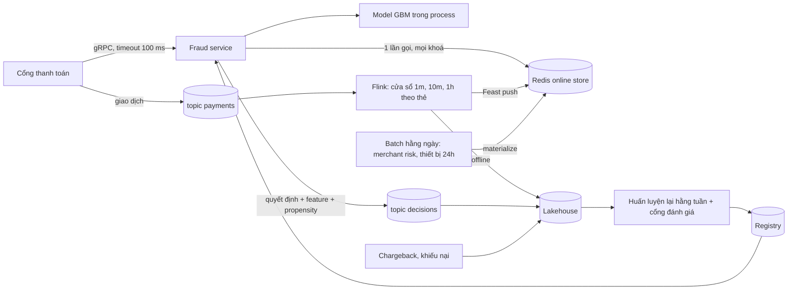

# Hướng làm và rubric: chống gian lận realtime dưới 100 ms

Không có một đáp án duy nhất. Dưới đây là một thiết kế hợp lý có số, rồi rubric 100 điểm. Điều được chấm là lập luận: mỗi con số
đến từ đâu, mỗi lựa chọn đánh đổi cái gì.

## Thiết kế mẫu

**Ngân sách độ trễ (p99).** Mạng cổng tới service 10 ms; parse và kiểm tra 2 ms; đọc online store một lần gom mọi khoá (thẻ, tài
khoản, merchant, thiết bị) 10 ms; feature của request (số tiền so trung bình, khoảng cách tới giao dịch trước) 3 ms; model cây 300
cây 5 ms; luật và ghi quyết định bất đồng bộ 3 ms; còn lại khoảng 60 ms dự phòng cho đuôi GC, retry một lần đọc store, và đỉnh tải.
Đo từng chặng bằng span OpenTelemetry trong service, và đo tổng ở cổng (client) chứ không trong service.

**Feature.** Ba nhóm: (1) stream theo thẻ: sliding 1 phút bước 10 giây, 10 phút bước 1 phút, 1 giờ bước 5 phút, Flink keyed state
RocksDB, watermark bounded out-of-orderness 5 giây, allowed lateness 30 giây, sự kiện muộn hơn ghi side output để backfill offline. SLO
freshness p95 dưới 15 giây, đo bằng `now - event_timestamp` đọc từ online store ở phía serving. (2) batch hằng ngày: merchant risk,
số thiết bị 24 giờ, SLO tuổi dưới 26 giờ. (3) feature của chính request tính trong service bằng **cùng hàm** với job offline (thư viện
feature dùng chung, bài module 06), vì giao dịch đang chấm chưa có trong stream. Khi huấn luyện, feature stream lấy point-in-time
**trước** giao dịch, không tính chính giao dịch đó, để khớp serving.

**Model và ngưỡng.** GBM trên feature trên; chỉ số offline PR-AUC và recall tại tỉ lệ chặn nhầm 0.5%; ngưỡng chọn theo chi phí kỳ vọng
(giá trị gian lận lọt so với chi phí chặn nhầm và tỉ lệ khách bỏ đi), có vùng giữa "xác thực thêm" (OTP). Không online learning cho model
chính: nhãn chậm 30–90 ngày, rủi ro đầu độc, cần giải trình. Model online có thể chạy shadow làm chỉ báo drift.

**Nhãn và feedback loop.** Nhãn từ chargeback (chậm) và khiếu nại chặn nhầm (nhanh, chỉ cho nhãn âm). Giao dịch bị chặn không có nhãn:
exploration 1–2% ở vùng điểm vừa phải, ghi propensity trong topic `decisions`, huấn luyện và đánh giá với IPW; giao dịch xác thực thêm
qua được OTP là nhãn yếu.

**Fallback.** Store chậm quá 30 ms: dùng giá trị mặc định cho nhóm stream và model dự phòng không dùng feature stream (đã huấn luyện và
đánh giá riêng). Model chết hoặc service quá hạn: cổng áp bộ luật tĩnh hiện có, không phải "cho qua tất cả". Feature stream cũ quá 5
phút (watermark kẹt, lag): cờ tự chuyển sang model dự phòng, cảnh báo.

**Rollout và giám sát.** Shadow 2 tuần so điểm và quyết định với hệ cũ; canary 5% theo merchant; cảnh báo: consumer lag theo thời gian,
freshness p95, tỉ lệ chặn theo giờ (lệch quá 30% so với cùng giờ tuần trước), phân phối điểm (PSI), tỉ lệ fallback.

## Rubric (100 điểm)

| Mục | Điểm | Đạt đủ điểm khi |
| --- | --- | --- |
| Kiến trúc online và offline | 15 | Đường nóng đồng bộ tối thiểu; stream, batch, request tách bạch; log quyết định cho huấn luyện lại |
| Ngân sách độ trễ | 15 | Số cho từng chặng, tổng ≤ 100 ms p99, có dự phòng; đo ở client; một lần gọi store gom khoá |
| Feature stream | 15 | Loại cửa sổ đúng với định nghĩa feature; watermark và lateness có số và lý do; xử lý sự kiện muộn |
| Freshness | 10 | SLO theo từng nhóm; đo theo event time từ phía đọc; hành vi khi vượt SLO |
| Skew train/serve | 10 | Feature của request dùng chung code; point-in-time loại chính giao dịch; kiểu dữ liệu cố định |
| Model, ngưỡng, online learning | 10 | Chỉ số gắn chi phí; ngưỡng theo chi phí; lập luận có hay không online learning |
| Nhãn và feedback loop | 10 | Độ trễ nhãn; exploration và propensity; IPW hoặc tương đương |
| Fallback | 10 | Ít nhất ba chế độ hỏng có hành vi rõ, mặc định an toàn không phải "cho qua tất cả" |
| Rollout và giám sát | 5 | Shadow, canary, cảnh báo chất lượng chứ không chỉ hạ tầng |

Trừ điểm: cộng ngân sách vượt 100 ms (-10); dùng processing time cho cửa sổ (-10); không nói giao dịch bị chặn không có nhãn (-10);
gọi tuần tự nhiều store trên đường nóng mà không nói đuôi p99 (-5).

## Câu đào sâu người phỏng vấn hay hỏi

- Một thẻ bị quẹt 50 lần trong 10 giây (tấn công thử thẻ): feature cửa sổ 1 phút có kịp không? (Không, nếu freshness 15 giây: cần đếm
  ngay trong service bằng bộ đếm nguyên tử theo thẻ, hoặc key-value tăng dần đồng bộ.)
- Partition theo thẻ hay theo merchant? Merchant lớn tạo partition nóng.
- Ngày sale lưu lượng gấp 4: thành phần nào hỏng trước, kế hoạch dung lượng thế nào?
