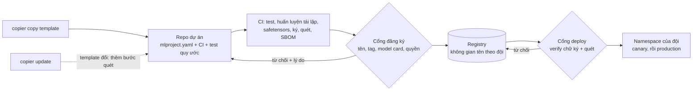
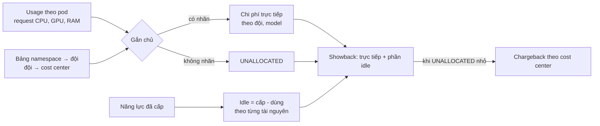
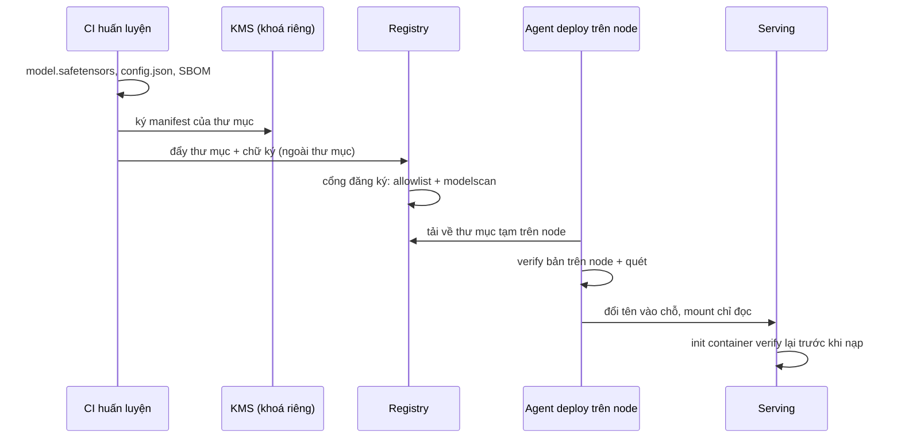

# Nền tảng ML nhiều đội và bảo mật model

Khi chỉ có một đội làm ML, "nền tảng" là vài script và một registry. Khi có năm đội, ba câu hỏi mà trước đó không ai hỏi trở thành việc
hằng ngày: **ai được làm gì** (đăng ký, deploy model nào, đọc dữ liệu nào), **ai trả tiền cho cái gì** (cụm GPU dùng chung chạy 30% thì 70%
còn lại thuộc về ai), và **model đang chạy có đúng là model đã duyệt không** (chuỗi cung ứng của model: tệp pickle chạy code khi nạp,
model gốc tải từ Internet, một bản sao trên node bị sửa). Module này dạy cách một đội nền tảng nhỏ trả lời ba câu đó bằng golden path,
cổng tự động và số đo, thay vì bằng họp và văn bản quy định.

Nói thẳng: đây là **kiến thức** tầng senior, không thay được kinh nghiệm vận hành một nền tảng thật. Thiết kế quyền cho năm đội trên giấy
khác xa việc thuyết phục một đội lâu đời bỏ script deploy riêng, hay quyết định có cho bypass cổng quét lúc 2 giờ sáng khi đang có sự cố.
Các bài tập ở đây dùng công cụ thật (Copier, MLflow, modelscan, model-signing, cyclonedx-py) trên dữ liệu và khoá sinh tại chỗ để bạn hiểu
cơ chế và giới hạn của từng lớp; phần "làm sao cho năm đội chịu dùng" chỉ đến từ làm thật.

Module dựa trên module 04 (registry), 08 (CI/CD), 12 (governance, chi phí, dịch vụ cloud), 13-15 (Kubernetes, KEDA, Kueue).

## 0. Cài đặt

Mọi gói Python đã có trong môi trường mặc định (`uv sync`, group `mlops-senior`); riêng modelscan chạy trong container vì xung đột
phiên bản `rich`/`tomlkit` với môi trường mặc định (CONTENT_SPEC mục Track MLOps).

| Công cụ | Phiên bản đã kiểm | Dùng ở | Ghi chú |
| --- | --- | --- | --- |
| `copier` | 9.19.1 | Basic 01 | `uv run copier --version`; test chạy trong sandbox `bwrap` |
| `mlflow` | như module 04 | Basic 02 | registry SQLite tạm, không cần stack |
| `safetensors` | 0.8.0 | Intermediate 01 | |
| `modelscan` | 0.8.8 | Intermediate 01, 02 | image `mlops-modelscan:0.8.8`, build tự động lần đầu từ `setup/mlops/modelscan/` (base ghim digest, `pip install --require-hashes`); chạy `--network none`, mount chỉ đọc |
| `model-signing` | 1.1.1 | Intermediate 02, 04 | ký bằng khoá EC sinh tại chỗ, offline; kèm `pyopenssl` 26.4.0 |
| `cyclonedx-bom` | 7.5.0 | Intermediate 03 | `uv run python -m cyclonedx_py --version`; CycloneDX 1.6 |
| `bwrap` (bubblewrap) | bản của distro | Basic 01 | `sudo apt install bubblewrap`; thiếu thì test skip kèm hướng dẫn |

Cần Docker cho các bài dùng modelscan. Build trước để lần chạy test đầu không chờ:

```bash
uv run python -c "import mlopskit, pathlib, tempfile; p = pathlib.Path(tempfile.mkdtemp()) / 'x.json'; p.write_text('{}'); print(mlopskit.modelscan_run(p).returncode)"
```

In `3` (không có gì để quét) là image đã sẵn sàng. Gỡ: `docker image rm mlops-modelscan:0.8.8`. Các gói Python gỡ cùng group `mlops-senior`
của `pyproject.toml`.

## 1. Nền tảng cho nhiều đội: golden path, template, self-service

Đội nền tảng 3 người không thể review mọi model của 5 đội. Cách mở rộng là **golden path**: một con đường đã được lát sẵn mà đi theo thì
mọi quy định (tag chi phí, model card, quét, ký, SLO) tự động đúng, và đi theo nó **nhanh hơn** tự làm. Từ "golden path" (Spotify) nhấn
vào chữ "dễ nhất", không phải "bắt buộc": nền tảng thắng bằng cách làm cho việc đúng thành việc ít công nhất.

Ba mảnh của golden path cho ML:

| Mảnh | Làm gì | Công cụ ví dụ |
| --- | --- | --- |
| Template dự án | Sinh repo mới có cấu trúc, CI, test canh quy ước, metadata đúng | Copier, Cookiecutter, Backstage Software Templates |
| Cổng tự động | Kiểm lúc đăng ký, lúc deploy; từ chối kèm lý do đọc được | code cổng (bài Basic 02, Intermediate 01-02), admission policy (Kyverno, Gatekeeper) |
| Self-service | Đội tự tạo dự án, tự đăng ký model hợp lệ, tự deploy canary trong không gian của mình | API hoặc CLI của nền tảng, GitOps |



**Copier** khác Cookiecutter ở chỗ nhớ câu trả lời (`.copier-answers.yml`) và `copier update` kéo thay đổi của template về dự án đã sinh,
giải xung đột như merge. Đó là điều kiện để golden path sống được: khi nền tảng thêm bước quét model vào CI, 40 repo nhận được bằng một
lệnh chứ không phải 40 pull request viết tay. Câu hỏi bắt buộc như `owner`, `cost_center` không có default để `--defaults` (chế độ không
hỏi) thất bại thay vì điền giá trị rác. Template **không** nên có `_tasks` (chạy lệnh shell trên máy người sinh dự án): Copier đòi cờ
`--trust`, và một template bị chiếm sẽ chạy code trên máy mọi kỹ sư. Bài Basic 01.

Golden path phải có **ngoại lệ có hạn**: đội lâu đời với script deploy riêng, model pickle từ năm 2021. Ngoại lệ ghi rõ ai cho, đến khi
nào, điều kiện thoát; không có hạn thì ngoại lệ trở thành con đường thứ hai.

## 2. Chuẩn hoá registry và phân quyền

Registry chung của nhiều đội cần ba thứ mà registry của một đội không cần:

- **Quy ước tên có không gian tên theo đội**: `<team>-<model>` (MLflow không có schema) hoặc `catalog.schema.model` (Unity Catalog của
  Databricks, mỗi đội một schema). Tên quyết định quyền: đội `fraud` không đăng ký được `pricing-*`.
- **Tag bắt buộc**: `owner` (người nhận alert và trả lời audit), `team`, `cost_center` (ai trả tiền, mục 3), thường thêm
  `data_classification` để cổng deploy chặn model huấn luyện trên dữ liệu nhạy cảm (vd. dữ liệu thẻ thuộc phạm vi PCI DSS) đi ra ngoài phạm vi.
- **Model card**: mục đích sử dụng, dữ liệu huấn luyện, metric, giới hạn (module 12 mục 2 có model card cho một model; ở đây là luật cho
  mọi model).

Cổng trong code chỉ có giá trị khi registry **từ chối mọi đường khác**. Hai lớp:

| Lớp | Làm gì | Ví dụ |
| --- | --- | --- |
| Quyền trên registry | Người dùng chỉ đọc; service account của cổng mới được tạo version; quyền theo registered model hay schema | MLflow `--app-name basic-auth` (quyền `READ`, `EDIT`, `MANAGE` theo registered model), Unity Catalog `GRANT CREATE MODEL ON SCHEMA ml.pricing`, IAM của SageMaker Model Registry |
| Audit định kỳ | Quét mọi version, báo version vi phạm quy ước (lọt qua trước khi có cổng, hoặc qua đường vòng) | `audit_registry` của bài Basic 02, chạy hằng đêm, báo cho chủ sở hữu |

Quyền cluster (RBAC theo namespace, NetworkPolicy, ResourceQuota) theo cùng nguyên tắc: một đội một namespace, LocalQueue Kueue riêng
(module 15), service account của pipeline deploy chỉ ghi được namespace của đội đó. Bài Basic 02 viết cổng đăng ký và audit trên registry
MLflow thật.

**Bí mật (secret) của nền tảng** đi cùng mô hình quyền (module 01 mục cấu hình đã nói: bí mật không bao giờ vào YAML trong Git). Nguồn
duy nhất là secret manager (Vault, AWS Secrets Manager, GCP Secret Manager); vào cluster qua External Secrets Operator hay CSI driver thành
Secret của **đúng namespace** cần nó; workload lấy quyền cloud bằng workload identity (IRSA, GKE Workload Identity) thay vì khoá truy cập dài
hạn. Ba chỗ bí mật hay rò trong ML: tham số và tag của run MLflow (ai log cả `os.environ`), notebook đã lưu output, và chính artifact model
(pipeline tiền xử lý đóng gói kèm chuỗi kết nối). Khoá ký model (mục 6) là bí mật quan trọng nhất của chuỗi này: chỉ hệ thống ký của CI
được dùng, tốt nhất qua KMS không bao giờ lộ khoá ra ngoài.

## 3. FinOps cho ML: cost attribution, showback, chargeback, idle

Module 12 mục 3 ước tính chi phí của một model. Ở quy mô nhiều đội, câu hỏi đổi thành: **hoá đơn tháng này của cụm dùng chung chia cho ai**.

Ba khái niệm:

- **Cost attribution**: gán từng đồng chi phí cho một chủ (đội, model, cost center) qua nhãn. Nhãn `team` lấy từ namespace, `model` từ
  nhãn pod; thứ không gán được vào một dòng `UNALLOCATED` hiện rõ, không bị chia đều hay bỏ đi.
- **Showback và chargeback**: showback cho đội **thấy** chi phí của mình; chargeback **trừ** vào ngân sách của đội. Bắt đầu bằng showback
  cho tới khi phần chưa gắn nhãn đủ nhỏ (vd. dưới 5%), nếu không các đội sẽ cãi nhau về con số thay vì sửa nhãn.
- **Chi phí idle**: năng lực đã cấp mà không ai dùng. Cụm chạy 30% nghĩa là 70% hoá đơn là idle; báo cáo chỉ cộng phần đã dùng sẽ giấu
  phần lớn nhất. Idle tính **theo từng loại tài nguyên** (CPU dư không bù cho GPU nằm im) rồi chia theo một chính sách mà mọi đội biết.



Tính theo **request**, không theo mức dùng thật: scheduler giữ chỗ theo request, pod xin 4 GPU mà dùng 10% vẫn chặn đội khác. Kèm theo
chỉ số đơn vị để đội tự tối ưu: chi phí trên 1 000 dự đoán, chi phí mỗi lần retrain so với mức cải thiện metric, tỉ lệ dùng trên request.
Đòn bẩy giảm chi phí thường theo thứ tự: rightsizing request, scale-to-zero cho model ít lưu lượng (KEDA, module 14), hàng đợi cho GPU
huấn luyện thay vì giữ node (Kueue, module 15), rồi mới tới đổi loại máy hay mua cam kết dài hạn. Ở nơi làm việc, dữ liệu chi phí theo
pod đến từ OpenCost hay Kubecost, phần ngoài cluster từ hoá đơn cloud có tag. Bài Basic 03.

## 4. Build vs buy: Databricks, SageMaker, Vertex AI hay open source

Module 12 mục 4 giới thiệu các dịch vụ cloud. Ở tầng senior, câu hỏi là có nên **mua nền tảng** thay vì tự vận hành stack open source
của module 04-16 (MLflow, Kubernetes, KServe, Feast, Kueue, KEDA).

| Phương án | Mạnh | Yếu | Hợp khi |
| --- | --- | --- | --- |
| Open source tự vận hành | compute rẻ nhất khi dùng cao; kiểm soát hoàn toàn; không phí nền tảng | cần người vận hành, nâng cấp, trực; thời gian dựng | đội nền tảng đủ người, mức dùng cao và ổn định, ràng buộc đặc thù |
| SageMaker / Vertex AI | ít vận hành; tích hợp IAM, mạng, giám sát của cloud; GPU theo giờ | phí cộng thêm trên compute; API riêng; lock-in | đã ở cloud đó, đội nền tảng nhỏ, tải theo đợt |
| Databricks | dữ liệu và ML một chỗ (Spark, Delta, MLflow managed, Unity Catalog cho quyền dữ liệu và model) | phí DBU; mạnh nhất khi dữ liệu cũng ở đó | đội dữ liệu đã hay sẽ dùng Databricks |
| Lai | managed cho huấn luyện, notebook; tự vận hành serving và lớp quy ước | hai nơi vận hành | phổ biến nhất ở công ty vừa |

Quyết định đúng thường không phải "tất cả hay không": tách nền tảng thành lớp (lưu trữ, huấn luyện, registry, serving, quy ước và cổng) và
hỏi từng lớp hai câu: lớp này có phải lợi thế cạnh tranh của công ty không, và đội có đủ người để trực nó không. **TCO** phải có chi phí
**người** (3 kỹ sư nền tảng có thể tốn ngang hoá đơn hạ tầng), chi phí di chuyển và chi phí rời đi, không chỉ hoá đơn cloud. Giảm
lock-in bằng định dạng mở (safetensors, ONNX, Parquet/Delta/Iceberg), serving là container chuẩn, và một lớp mỏng nội bộ giữa pipeline với
SDK của hãng. Lớp quy ước và cổng (template, tên, tag, quét, ký, báo cáo chi phí) gần như luôn tự làm, vì không nhà cung cấp nào biết quy ước
của công ty bạn. Bài Advanced 02 ra quyết định có rubric; Advanced 01 thiết kế cả nền tảng cho 5 đội.

## 5. Chuỗi cung ứng của model: pickle, safetensors, quét model

Một model đi qua nhiều tay trước khi phục vụ: model gốc tải từ Hugging Face, dependency của pipeline, notebook của ai đó, artifact store,
bản sao trên node. Mỗi chặng là một chỗ có thể bị thay. Nguy hiểm nhất là **định dạng có code**:

- **Pickle chạy code khi nạp.** Pickle là chương trình cho máy ảo của module `pickle`: opcode `GLOBAL` nạp hàm theo tên (`builtins.exec`,
  `os.system`), `REDUCE` gọi nó. `__reduce__` cho mọi đối tượng tự mô tả "để dựng lại tôi, hãy gọi hàm này". `joblib.load`,
  `torch.load(weights_only=False)`, `pandas.read_pickle` đều đi qua pickle. Chỉ cần `pickle.loads` là code chạy, không cần gọi gì thêm.
- **safetensors không có code.** Tệp là header JSON (tên tensor, dtype, shape, offset) cộng một khối byte; loader không có cách gọi hàm. Nạp
  nhanh (mmap) và an toàn theo thiết kế. Model cây dùng định dạng gốc của thư viện (văn bản hay JSON của LightGBM, XGBoost); mạng nơ-ron dùng
  safetensors hoặc ONNX. Keras `.h5` cũ có lớp `Lambda` chứa code, cũng cần coi chừng.
- **Máy quét model** như **modelscan** (Protect AI) đọc opcode pickle mà không nạp, báo khi thấy tham chiếu tới module/hàm nguy hiểm
  (`builtins.exec` mức CRITICAL). Giới hạn đã thấy trong bài Intermediate 01: quét theo **danh sách chặn** (payload gọi
  `pathlib.Path.write_text` qua được), chọn scanner theo **đuôi tệp** (pickle đặt tên `.safetensors` thì "không có gì để quét", đuôi `.bin`
  bị bỏ qua), và có lúc không parse được (pickle `joblib` có mảng numpy báo lỗi parse).

Vì vậy cổng nhận model có hai lớp độc lập: **allowlist theo nội dung** (nhận diện định dạng bằng byte đầu, chỉ nhận định dạng không chứa
code) là lớp chính; **máy quét** là lớp phụ cho đường chuyển tiếp còn nhận pickle, và chỉ tin khi máy quét **đã đọc** đúng tệp đó. Mọi
trường hợp không chắc (máy quét lỗi, định dạng lạ, symlink) đều **fail closed**. Máy quét chạy trong sandbox không mạng, mount chỉ đọc,
như `mlopskit.modelscan_run`, vì chính nó cũng là phần mềm đọc dữ liệu không tin cậy.

**An toàn của bài tập.** Pickle "độc hại" của module (`seckit.py`) đã vô hại hoá: nạp vào chỉ ghi chữ `pwned` vào một tệp đánh dấu trong thư
mục tạm của test, không lệnh hệ thống, không mạng. Test không bao giờ nạp tệp model, trừ đúng một ca cố ý chứng minh rủi ro trong thư mục
tạm; quét luôn qua container. Khi tự thử, làm như vậy: không bao giờ nạp pickle lạ ngoài sandbox.

## 6. Ký model, Sigstore, SBOM và cổng deploy

Chữ ký trả lời "đây có đúng là thứ pipeline của ta đã tạo không"; quét trả lời "thứ đó có nguy hiểm khi nạp không". Hai câu khác nhau:
model ký đúng vẫn có payload nếu chính pipeline bị chiếm; model quét sạch vẫn có thể đã bị thay.

**model-signing** (dự án model-transparency của OpenSSF, bản 1.1.1) băm từng tệp trong thư mục model, ký manifest, bọc trong DSSE envelope
theo định dạng bundle của Sigstore. Verify phát hiện sửa byte, thêm, xoá, đổi tên tệp. Ba cách ký:

| Cách | Danh tính | Hợp khi |
| --- | --- | --- |
| Khoá riêng (EC) | ai giữ khoá | offline, khoá trong KMS/HSM của CI; module dùng cách này (khoá sinh tại chỗ trong test) |
| Chứng chỉ (PKI nội bộ) | chứng chỉ do CA công ty cấp | công ty đã có PKI |
| Sigstore keyless | danh tính OIDC (email, workflow CI), chứng chỉ ngắn hạn từ Fulcio, ghi log minh bạch Rekor | repo công khai, không muốn giữ khoá dài hạn; cần mạng |

Sigstore keyless là hướng dẫn tuỳ chọn ở `SOLUTION.md` bài Intermediate 02; test của module không cần mạng.



Ba bài học của chuỗi này, mỗi bài một bài tập:

- **Verify fail closed với mọi lỗi** (Intermediate 02). Thư viện ném `ValueError` khi không khớp, nhưng chữ ký thiếu, rỗng, hỏng ném lỗi
  khác. Không bật `ignore_unsigned_files` (cho phép thêm tệp lạ như `preprocess.pkl` mà vẫn qua).
- **Verify đúng bản sẽ dùng** (Intermediate 04, bài sự cố). Mỗi bản sao mới (cache trên node, volume, image) cần được kiểm ở nơi nó được
  dùng; câu hỏi review: "giữa lúc kiểm và lúc dùng, ai ghi được vào chỗ này?"
- **Quản lý khoá**: khoá riêng chỉ trong hệ thống ký của CI; cổng chỉ có khoá công khai; có quy trình thu hồi, xoay khoá, ký lại.

**SBOM** (software bill of materials) liệt kê mọi gói và phiên bản trong image serving, để khi có CVE trả lời được "service nào đang chạy
bản đó" mà không vào từng container. CycloneDX 1.6 có thêm **ML-BOM**: thành phần `machine-learning-model` và `data` (model gốc kèm hash,
dataset, tham số). SBOM sinh từ **môi trường đã build** (`cyclonedx-py environment`, Syft cho image), không chỉ từ requirements; thành phần
không có phiên bản là lỗi. So SBOM của bản mới với bản đang chạy là một phần của review phát hành. Bài Intermediate 03.

**Phân quyền registry** khép chuỗi: chỉ service account của pipeline ghi được version, chỉ cổng chuyển stage hay alias `production`, người
dùng chỉ đọc (mục 2). Khung SLSA (Supply-chain Levels for Software Artifacts) đặt tên cho các mức này: build có provenance, provenance được
ký, build chạy trên hạ tầng cô lập.

## 7. Tài liệu tham khảo

- Copier: https://copier.readthedocs.io/ (validator, `_answers_file`, `copier update`, lý do của `--trust`)
- Spotify Engineering, *How We Use Golden Paths to Solve Fragmentation in Our Software Ecosystem*, 2020: https://engineering.atspotify.com/2020/08/how-we-use-golden-paths-to-solve-fragmentation-in-our-software-ecosystem/
- MLflow, *Authentication and permissions* (basic-auth app): https://mlflow.org/docs/latest/auth/index.html
- Databricks Unity Catalog, models in Unity Catalog: https://docs.databricks.com/en/machine-learning/manage-model-lifecycle/index.html
- FinOps Foundation, *FinOps for AI* và các khái niệm showback, chargeback: https://www.finops.org/
- OpenCost (chi phí theo pod, namespace, nhãn trên Kubernetes): https://www.opencost.io/docs/
- Python docs, `pickle` (cảnh báo bảo mật ở đầu trang): https://docs.python.org/3/library/pickle.html
- Hugging Face, safetensors: https://huggingface.co/docs/safetensors/ và *Pickle scanning*: https://huggingface.co/docs/hub/security-pickle
- Protect AI, modelscan: https://github.com/protectai/modelscan
- OpenSSF model-transparency (model-signing): https://github.com/sigstore/model-transparency
- Sigstore (Fulcio, Rekor, keyless signing): https://docs.sigstore.dev/
- CycloneDX 1.6 và ML-BOM: https://cyclonedx.org/capabilities/mlbom/ ; cyclonedx-python: https://cyclonedx-bom-tool.readthedocs.io/
- SLSA: https://slsa.dev/spec/v1.0/
- OWASP Machine Learning Security Top 10 (ML06 AI Supply Chain Attacks): https://owasp.org/www-project-machine-learning-security-top-10/
- Module 12 mục 2-4 (governance, chi phí, dịch vụ cloud), module 14-15 (KEDA, Kueue) của track này.
