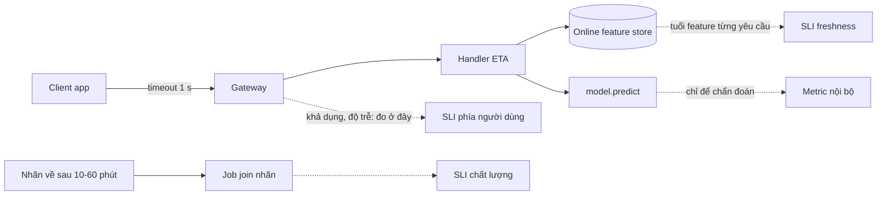
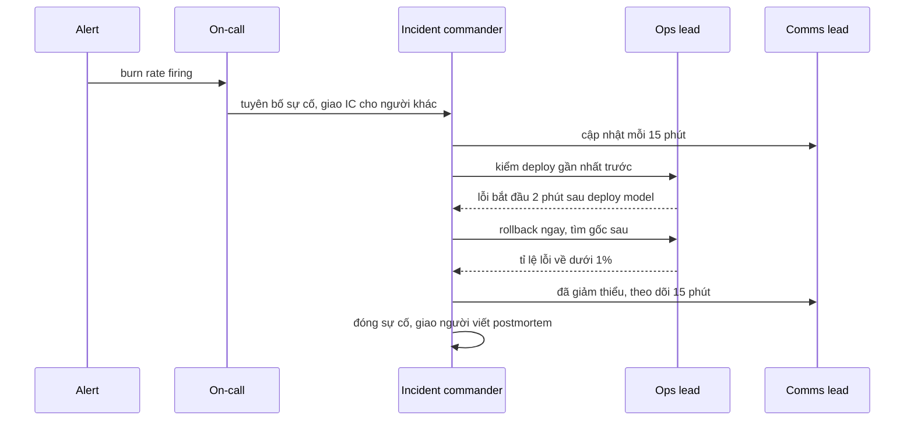
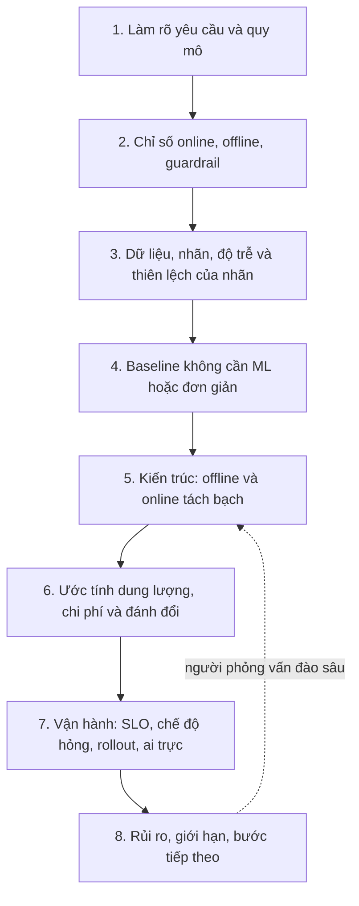

# ML system design và dẫn dắt vận hành

Module cuối của tầng senior không thêm công cụ mới. Nó dạy những việc mà một kỹ sư senior làm nhiều hơn viết code: định nghĩa "chạy
tốt" bằng SLO đo đúng chỗ, quyết định khi nào dừng ra tính năng vì error budget cạn, điều phối một sự cố khi năm người cùng nói, viết
postmortem không đổ lỗi, viết và review design doc, và cân chi phí với độ trễ và chất lượng ở quy mô lớn. Cuối module là khung trả lời
ML system design và bộ đề mức senior có rubric.

Nói thẳng: đây là **kiến thức**, không thay được kinh nghiệm production. Bạn có thể học thuộc vai trò incident commander, nhưng chỉ
lần đầu đứng giữa một sự cố thật lúc 2 giờ sáng mới cho bạn biết mình phản ứng thế nào. Các bài tập ở đây là bản tập dượt (log dựng
sẵn, sự cố phát lại, rubric tự chấm) để khi gặp thật bạn có khung để dựa vào và học nhanh hơn, không phải để thay lần gặp thật đó.

## 1. SLI và SLO cho ML: khả dụng, độ trễ, chất lượng, freshness

SLI (service level indicator) là một tỉ lệ sự kiện tốt trên sự kiện hợp lệ; SLO là mục tiêu cho tỉ lệ đó trong một cửa sổ. Module 09
đã làm SLO khả dụng và độ trễ cho service ETA. Một service ML có thể trả 200 trong 20 ms mà vẫn hỏng: dự đoán sai vì model cũ, hoặc đúng
model nhưng dùng feature cũ ba giờ. Vì vậy service ML cần bốn loại SLI:

| SLI | Sự kiện tốt / sự kiện hợp lệ | Đo ở đâu | Bẫy hay gặp |
| --- | --- | --- | --- |
| Khả dụng | yêu cầu trả mã dưới 500 / mọi yêu cầu client gửi | load balancer, gateway, hoặc client | đo trong ứng dụng thì bỏ sót yêu cầu bị cắt ở gateway |
| Độ trễ | yêu cầu thành công trả trong ngưỡng / yêu cầu thành công | cùng chỗ với khả dụng | đo mỗi hàm `predict` thì bỏ qua thời gian lấy feature |
| Chất lượng | dự đoán có sai số trong ngưỡng / dự đoán đã có nhãn | job join nhãn | nhãn về muộn và thưa; không có nhãn nghĩa là chưa biết, không phải đạt |
| Freshness | yêu cầu (hoặc phút) có feature không cũ hơn ngưỡng / mọi yêu cầu (hoặc phút) | service ghi tuổi feature từng yêu cầu, hoặc gauge thời điểm materialize | job batch "xanh" vẫn có thể không ghi gì |

Nguyên tắc chọn: SLI đo **thứ người dùng thấy**, ở **điểm gần người dùng nhất** mà bạn kiểm soát. CPU, RAM, độ dài hàng đợi là tín hiệu
để chẩn đoán, không phải SLI. Khi khách phàn nàn mà SLO vẫn xanh, nghi chính SLI trước (bài sự cố Intermediate 03).

Chọn mục tiêu SLO từ phía người dùng và kinh doanh, không từ con số hệ thống đang đạt. 99.9% khả dụng trong 30 ngày là 43 phút lỗi toàn
phần; nếu nghiệp vụ chịu được 3 giờ thì 99.5% (216 phút) rẻ hơn rất nhiều để giữ. SLO chất lượng thường lỏng hơn (vd. 98% dự đoán sai
không quá 10 phút) và cửa sổ dài hơn vì nhãn về chậm. Bài Basic 01 tính cả bốn SLI từ log.

## 2. Error budget và burn rate nhiều cửa sổ

Error budget là phần không hoàn hảo được phép: $$\text{budget} = (1 - \text{SLO}) \times \text{cửa sổ}$$. Burn rate là tốc độ đốt so với
mức vừa hết đúng cuối cửa sổ: $$\text{burn rate} = \frac{\text{tỉ lệ sự kiện xấu}}{1 - \text{SLO}}$$. Burn rate $$B$$ trong cửa sổ dài
$$w$$ tiêu $$B \times w / 30\,\text{ngày}$$ budget; burn 14.4 trong 1 giờ tiêu 2% budget 30 ngày.

Alert theo burn rate với **hai cửa sổ** (dài để chắc là đủ nặng, ngắn bằng khoảng 1/12 để chắc là còn đang xảy ra và để alert tự tắt
nhanh) là cách Google SRE Workbook khuyên dùng. Phần ML là chọn tầng hợp với nhịp của SLI:

| SLI | Tầng nhanh (page) | Tầng chậm (ticket) | Vì sao |
| --- | --- | --- | --- |
| Khả dụng, độ trễ | burn 14.4 trên 1h và 5m | burn 6 trên 6h và 30m; burn 1 trên 3d và 6h | mỗi giây có dữ liệu |
| Freshness | burn 14.4 trên 1h và 5m | burn 6 trên 6h và 30m | đo được mỗi phút |
| Chất lượng | burn 6 trên 6h và 30m | burn 3 trên 1d và 2h | nhãn về theo lô, cửa sổ 5 phút có lúc không có mẫu |

Thêm một alert cho trường hợp **không đo được**: nhãn ngừng về thì tỉ lệ chất lượng là 0/0, alert burn rate im lặng, dashboard xanh. Bài
Intermediate 01 viết đủ bốn alert này bằng rule Prometheus và chấm bằng `promtool test rules`.

Budget chỉ có ý nghĩa khi có **chính sách**: còn dưới một ngưỡng (vd. 25%) thì đóng băng thay đổi rủi ro (đổi model, đổi dependency) và ưu
tiên việc độ tin cậy; ngoại lệ do ai ký, có hạn. Ngược lại, budget còn nhiều là thứ để **tiêu có chủ đích**: thử model rẻ hơn, deploy nhanh
hơn. Một đội không bao giờ đụng tới budget có thể đang quá thận trọng.

## 3. Incident command và postmortem không đổ lỗi

Sự cố lớn thất bại vì phối hợp nhiều hơn vì kỹ thuật: năm người cùng debug, không ai cập nhật cho bên ngoài, không ai quyết. Mô hình
incident command (từ Incident Command System của lực lượng cứu hoả, qua Google SRE và PagerDuty) tách vai trò:

| Vai trò | Làm gì | Không làm gì |
| --- | --- | --- |
| Incident commander (IC) | giữ bức tranh chung, giao việc, quyết định (rollback, leo thang), giữ nhịp cập nhật | tự tay debug |
| Ops lead | điều tra, thực hiện thay đổi theo quyết định của IC, báo kết quả | thay đổi production mà IC không biết |
| Comms lead | cập nhật status page, kênh nội bộ, đội hỗ trợ theo chu kỳ cố định kể cả khi chưa có tin mới | hứa thời điểm sửa xong |
| Scribe (tuỳ quy mô) | ghi dòng thời gian: ai làm gì lúc nào, giả thuyết nào bị loại | |

Ba nguyên tắc: **giảm thiểu trước, tìm gốc sau** (rollback hay tắt tính năng khi đã có nghi phạm hợp lý, đừng chờ hiểu hết); **đối chiếu
thay đổi gần nhất** trước những thử nghiệm mù như restart; **mức độ nghiêm trọng theo tác động đo được** (vd. % budget đã tiêu), không theo
cảm giác. Mốc cần ghi: bắt đầu tác động, phát hiện, giảm thiểu, hết tác động; TTD và TTM là độ đo để cải thiện quy trình (bài
Intermediate 02 dựng hồ sơ này từ log, metric và chat).

**Postmortem không đổ lỗi** giả định rằng mọi người đã làm điều hợp lý với thông tin họ có lúc đó. Câu hỏi là "hệ thống nào để việc này xảy
ra mà không ai biết", không phải "ai làm sai". Lý do thực dụng: nếu nêu tên để trách, lần sau người ta giấu thông tin. Cấu trúc: tóm tắt,
tác động có số, dòng thời gian theo vai trò, nguyên nhân gốc và yếu tố góp phần (chuỗi cơ chế thiếu), điều tốt và điều may mắn, hành động
có chủ, hạn, cách kiểm, chia ba loại **ngăn chặn, phát hiện, giảm thiệt hại**. "Cẩn thận hơn" không phải hành động (bài Basic 03). Module 10
mục 7 có runbook và postmortem cho sự cố drift; ở đây là phần dẫn dắt.

## 4. Design doc và design review

Design doc là cách một senior thay đổi hệ thống mà không phải thuyết phục từng người một: viết ra, mời review, ghi quyết định. Doc tốt cho
một hệ thống ML thường có:

1. **Bối cảnh, yêu cầu có số, ngoài phạm vi.** Lưu lượng trung bình và đỉnh, ngân sách độ trễ, độ trễ nhãn, độ tươi feature, mục tiêu nghiệp vụ.
2. **SLO** (mục 1), nói rõ đo ở đâu.
3. **Kiến trúc**: đường online (serving, feature online) và offline (huấn luyện, feature batch, join nhãn) tách bạch.
4. **Phương án đã cân nhắc**: luôn gồm hiện trạng và phương án đơn giản nhất; lý do loại bằng chi phí, độ trễ, chất lượng.
5. **Ước tính dung lượng và chi phí** (back-of-envelope).
6. **Chế độ hỏng**: mỗi thành phần trên đường nóng chết thì sao, phát hiện bằng gì, fallback là gì.
7. **Rollout và rollback**: shadow, canary, tiêu chí viết trước.
8. **Câu hỏi mở** cho người review.

Design review là cuộc trò chuyện về rủi ro, không phải buổi chấm điểm. Người review hỏi những câu mà tác giả dễ bỏ qua:

| Nhóm | Câu hỏi review |
| --- | --- |
| Đo lường | Chỉ số offline có tương quan với chỉ số online không? SLO đo ở chỗ nào? Không có nhãn thì biết model tệ đi bằng gì? |
| Dữ liệu | Nhãn có thiên lệch do chính hệ thống (chỉ có nhãn cho thứ đã được cho qua, đã được gợi ý)? Feature online và offline tính cùng một code không? |
| Quy mô | Ở đỉnh gấp 5 lần thì sao? Thành phần nào hết trước? |
| Hỏng | Thành phần này chết thì luồng nghiệp vụ dừng hay rơi về fallback? Fallback được test lần cuối khi nào? |
| Vận hành | Ai trực? Rollback mất bao lâu? Đổi model có cần build lại không? |
| Chi phí | Mỗi điểm chất lượng thêm tốn bao nhiêu? Có phương án rẻ hơn 10 lần mà chỉ tệ hơn 1% không? |

Bài Advanced 01 viết design doc cho fraud realtime hoặc ETA, có test kiểm khung và rubric chấm nội dung.

## 5. Đánh đổi chi phí, độ trễ, chất lượng ở quy mô lớn

Ở quy mô nhỏ, model tốt nhất thường thắng. Ở quy mô lớn, mỗi mili giây và mỗi điểm chất lượng có giá. Các đòn bẩy chính:

| Đòn bẩy | Được gì | Mất gì | Khi nào dùng |
| --- | --- | --- | --- |
| Cache kết quả | trung bình giảm mạnh, chi phí model giảm theo hit rate | độ cũ; p99 không đổi nếu miss trên 1% | truy vấn lặp lại (trang chủ, truy vấn phổ biến) |
| Tính trước theo lô (batch) | độ trễ phục vụ gần 0, tận dụng máy rẻ | trả tiền cho mọi thực thể kể cả không ai hỏi; độ cũ tới chu kỳ làm mới | số thực thể nhỏ so với số câu hỏi, chấp nhận độ cũ |
| Realtime | feature tươi, chỉ tính cho người hỏi | replica bật cả ngày, đường nóng phức tạp | quyết định cần dữ liệu vài phút gần nhất (fraud) |
| Distillation, lượng tử hoá | model nhỏ hơn nhiều lần | chi phí một lần, giảm chất lượng, lặp lại mỗi khi teacher đổi | lưu lượng lớn và ổn định đủ để hoà vốn |
| Cascade, routing | ca dễ qua model rẻ, ca khó qua model đắt | thêm thành phần, cần bộ phân loại tin được | phân phối độ khó lệch (LLM, search) |
| Hai tầng (sinh ứng viên, xếp hạng) | chỉ chạy model đắt trên vài trăm ứng viên | recall của tầng đầu là trần chất lượng | recommendation, search |

Ba công thức bỏ túi (bài Basic 02 viết thành code):

- Cache: độ trễ trung bình $$= t_{\text{cache}} + (1 - h)\, t_{\text{model}}$$, số lần gọi model mỗi giờ $$= \text{qps} \times 3600 \times (1 - h)$$.
- Batch và realtime: batch tốn $$N_{\text{thực thể}} \times \text{số lần làm mới}$$ lượt chấm; realtime tốn số câu hỏi cộng chi phí replica cố định.
- Distillation hoà vốn sau $$\frac{\text{chi phí một lần}}{(\text{giá teacher} - \text{giá student}) \times \text{lưu lượng}}$$ ngày.

Mô hình đơn giản sai ở đâu: p99 của hỗn hợp cache và model trượt dần chứ không nhảy ở 1%; hit rate phụ thuộc TTL và tụt sau mỗi deploy
(cold cache); batch còn chi phí lưu trữ và độ trễ job. Dùng chúng để loại phương án nhanh, rồi đo thật trước khi quyết.

Quy tắc ra quyết định: ràng buộc cứng (p99, mức giảm chất lượng nằm trong budget) loại phương án trước, trong số còn lại mới tối ưu tiền;
đổi ràng buộc là việc của design review, không phải của một người.

## 6. Khung trả lời ML system design và bộ đề senior

Phỏng vấn ML system design 45 phút chấm cách bạn **dẫn dắt** hơn kiến trúc cuối cùng. Khung tám bước, nói thứ tự ra trước khi bắt đầu:

| Bước | Thời gian | Câu hỏi bạn tự trả lời |
| --- | --- | --- |
| 1. Yêu cầu | 5 phút | Ai dùng, quy mô đỉnh, ngân sách độ trễ, ràng buộc pháp lý, cái gì ngoài phạm vi? |
| 2. Chỉ số | 5 phút | Thành công đo bằng gì online? Chỉ số offline nào tương quan? Guardrail nào không được xấu đi? |
| 3. Dữ liệu và nhãn | 5 phút | Nhãn từ đâu, về sau bao lâu, thiên lệch gì (vị trí, chọn lọc, feedback loop)? |
| 4. Baseline | 3 phút | Luật hay heuristic nào làm được 70%? Model phải thắng nó bao nhiêu? |
| 5. Kiến trúc | 12 phút | Đường offline (huấn luyện, feature batch) và online (feature tươi, serving); feature store; log để join nhãn |
| 6. Ước tính | 5 phút | Bao nhiêu replica ở đỉnh, store bao lớn, tốn bao nhiêu mỗi tháng? |
| 7. Vận hành | 7 phút | SLO bốn loại, fallback, shadow và canary, retrain theo gì, ai trực |
| 8. Rủi ro | 3 phút | Chỗ nào là giả định, chỗ nào cần dữ liệu thật hay kinh nghiệm vận hành? |

Bộ đề senior của module (rubric chi tiết trong `SOLUTION.md` của bài tập):

| Đề | Bài | Điểm khó riêng mà rubric đòi |
| --- | --- | --- |
| Fraud realtime | Advanced 01 | nhãn chargeback về sau 30-90 ngày và thiên lệch do chính model chặn; feature cửa sổ 1 phút; fallback không dừng thanh toán |
| ETA ở quy mô lớn | Advanced 01 | feature tốc độ đường streaming; slice mưa và giờ cao điểm; mở thành phố mới (cold start) |
| Recommendation | Advanced 02 | hai tầng; cold start người bán mới; feedback loop làm gợi ý hẹp dần; guardrail đa dạng |
| Search ranking | Advanced 02 | thiên lệch vị trí trong log click; đuôi dài; trộn quảng cáo có guardrail mức liên quan |
| LLM platform | Advanced 02 | cổng chung, định tuyến theo độ nhạy dữ liệu, cô lập RAG theo đội, hạn mức GPU, chi phí theo đội, prompt injection |

Lỗi hay gặp nhất: vẽ model trước khi chốt chỉ số; không có baseline; quên đường offline (lấy nhãn ở đâu để huấn luyện lại?); không có
fallback; nói "dùng Kafka" mà không nói để làm gì.

## 7. Ôn nhanh: OpenTelemetry và LLM serving (từ AE 20)

Hai mảnh hay xuất hiện trong system design mức senior đã được dạy kỹ ở track AI Engineer, ở đây chỉ nhắc chỗ nối:

- **Trace với OpenTelemetry** ([AE 20 mục 3](../../../ai-engineer/modules/20-evaluation-production/README.md)): trace phân tán cho thấy một
  yêu cầu đi qua những span nào và mất bao lâu ở đâu. Với SLO, nó trả lời câu "đang đo ở span nào" (bài sự cố Intermediate 03 là ví dụ
  SLI đo ở span sai). Module 09 mục 6 đã ôn phần instrument cho service ETA.
- **LLM serving** ([AE 20 mục 4 và 6](../../../ai-engineer/modules/20-evaluation-production/README.md)): vLLM và llama.cpp server,
  continuous batching, speculative decoding; SLO riêng của LLM (thời gian ra token đầu, token mỗi giây) và load test. Đề LLM platform ở bài
  Advanced 02 dùng các số đo này cho ước tính GPU và hạn mức theo đội.
- **Eval cho LLM** ([AE 20 mục 1 và 2](../../../ai-engineer/modules/20-evaluation-production/README.md)): bộ đánh giá offline, LLM-as-judge
  hiệu chỉnh với nhãn người, dùng làm cổng promotion khi đổi model hay prompt, như cổng promotion ở module 04 cho model cổ điển.
- Khung đóng khung bài toán AI và ước tính chi phí token ở [AE 21](../../../ai-engineer/modules/21-ai-system-design/README.md) bổ sung cho
  mục 6 khi đề là sản phẩm LLM.

## 8. Tài liệu tham khảo

- Google SRE Book, *Service Level Objectives* và *Managing Incidents*: https://sre.google/sre-book/service-level-objectives/ và https://sre.google/sre-book/managing-incidents/
- Google SRE Workbook, *Alerting on SLOs* (burn rate nhiều cửa sổ) và *Implementing SLOs*: https://sre.google/workbook/alerting-on-slos/
- Google SRE Book, *Postmortem Culture: Learning from Failure*: https://sre.google/sre-book/postmortem-culture/
- PagerDuty Incident Response (vai trò IC, comms, scribe): https://response.pagerduty.com/
- Prometheus, *Unit testing for rules* (`promtool test rules`): https://prometheus.io/docs/prometheus/latest/configuration/unit_testing_rules/
- Chip Huyen, *Designing Machine Learning Systems*, O'Reilly 2022 (chương về feature online, batch và realtime, monitoring).
- Sculley et al., *Hidden Technical Debt in Machine Learning Systems*, NeurIPS 2015.
- Breck et al., *The ML Test Score: A Rubric for ML Production Readiness*, IEEE Big Data 2017.
- Google, *Rules of Machine Learning*: https://developers.google.com/machine-learning/guides/rules-of-ml
- Covington et al., *Deep Neural Networks for YouTube Recommendations*, RecSys 2016 (kiến trúc hai tầng).
- Joachims et al., *Unbiased Learning-to-Rank with Biased Feedback*, WSDM 2017 (thiên lệch vị trí).
- Hinton et al., *Distilling the Knowledge in a Neural Network*, 2015.
- Track AI Engineer module 20 và 21: `tracks/ai-engineer/modules/20-evaluation-production/`, `tracks/ai-engineer/modules/21-ai-system-design/`
