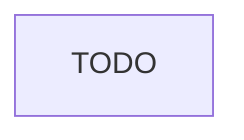

# Design doc: TODO

Đề: TODO

## 1. Bối cảnh, yêu cầu và ngoài phạm vi

TODO

| Yêu cầu | Con số |
| --- | --- |
| TODO | TODO |

Ngoài phạm vi:

- TODO

## 2. SLO

| SLI | Đo ở đâu | SLO | Cửa sổ |
| --- | --- | --- | --- |
| TODO | TODO | TODO | TODO |

## 3. Kiến trúc

TODO

## 4. Phương án và đánh đổi

| Phương án | Chi phí | Độ trễ | Chất lượng | Chọn |
| --- | --- | --- | --- | --- |
| TODO | TODO | TODO | TODO | TODO |

## 5. Ước tính dung lượng và chi phí

- TODO

## 6. Chế độ hỏng

| Hỏng | Phát hiện | Giảm thiểu |
| --- | --- | --- |
| TODO | TODO | TODO |

## 7. Rollout và rollback

- TODO

## 8. Câu hỏi cho design review

- TODO
