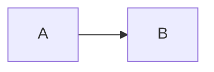

# Design doc: chống gian lận

Đề: fraud

## 1. Bối cảnh, yêu cầu và ngoài phạm vi

Cần chặn gian lận nhanh và chính xác.

| Yêu cầu | Con số |
| --- | --- |
| Nhanh | rất nhanh |

## 2. SLO

| SLI | Đo ở đâu | SLO | Cửa sổ |
| --- | --- | --- | --- |
| CPU | node | 80% | |

## 3. Kiến trúc

## 4. Phương án và đánh đổi

| Phương án | Chi phí | Độ trễ | Chất lượng | Chọn |
| --- | --- | --- | --- | --- |
| Deep learning | cao | cao | cao | có |
| XGBoost | thấp | thấp | khá | có |

## 5. Ước tính dung lượng và chi phí

- Đủ dùng.

## 6. Chế độ hỏng

| Hỏng | Phát hiện | Giảm thiểu |
| --- | --- | --- |
| Model chết | alert | restart |

## 7. Rollout và rollback

- Deploy dần.

## 8. Câu hỏi cho design review

- Có ổn không?
