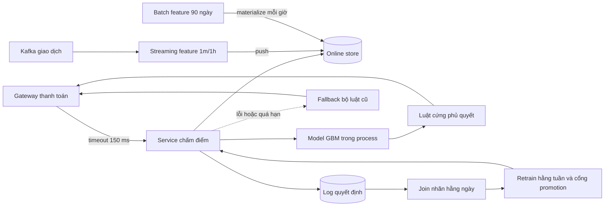

# Design doc: chấm điểm gian lận realtime cho ví điện tử

Đề: fraud

## 1. Bối cảnh, yêu cầu và ngoài phạm vi

Ví điện tử chấm từng giao dịch thanh toán trước khi chấp nhận: cho qua, chặn, hay đòi xác thực thêm (OTP). Hiện là bộ luật tĩnh do
đội rủi ro viết tay, bắt được khoảng 55% số tiền gian lận và chặn nhầm 0.9% giao dịch hợp lệ. Mục tiêu là model học máy chạy trong
luồng thanh toán, giữ luật cứng làm lớp bảo vệ cuối, và quan sát được chất lượng dù nhãn chargeback về sau hàng tháng.

| Yêu cầu | Con số |
| --- | --- |
| Lưu lượng | trung bình 800 TPS, đỉnh 4 000 TPS (ngày lương, khuyến mãi) |
| Độ trễ chấm điểm | p99 dưới 150 ms tính từ lúc gateway thanh toán gọi tới lúc nhận quyết định |
| Tỉ lệ gian lận | 0.08% giao dịch, khoảng 0.6% giá trị |
| Nhãn | báo cáo người dùng sau 1-3 ngày; chargeback sau 30-90 ngày |
| Feature tươi | đếm giao dịch theo tài khoản, thiết bị, merchant trong 1 phút và 1 giờ; trễ không quá 10 giây |
| Mục tiêu nghiệp vụ | bắt từ 75% giá trị gian lận, chặn nhầm dưới 0.5% giao dịch hợp lệ |

Ngoài phạm vi:

- Điều tra thủ công và công cụ cho đội rủi ro (chỉ cung cấp lý do và điểm số qua API).
- Chống rửa tiền theo quy định (AML) và báo cáo cho cơ quan quản lý, do hệ thống khác phụ trách.
- Huấn luyện online theo từng giao dịch: retrain theo lô hằng tuần là đủ cho giai đoạn này.

## 2. SLO

| SLI | Đo ở đâu | SLO | Cửa sổ |
| --- | --- | --- | --- |
| Khả dụng: tỉ lệ yêu cầu chấm điểm nhận được quyết định (kể cả từ fallback) | gateway thanh toán, phía gọi | 99.95% | 30d |
| Độ trễ: tỉ lệ quyết định trả trong 150 ms | gateway thanh toán, phía gọi | 99% | 30d |
| Freshness: tỉ lệ yêu cầu dùng feature cửa sổ 1 phút có tuổi không quá 10 giây | service chấm điểm, ghi tuổi feature theo từng yêu cầu | 99% | 30d |
| Chất lượng: recall theo giá trị trên nhãn báo cáo người dùng 3 ngày | job join nhãn hằng ngày | 75% | 28d trượt |
| Chặn nhầm: tỉ lệ giao dịch bị chặn mà người dùng xác minh là hợp lệ | job join khiếu nại hằng ngày | dưới 0.5% | 7d trượt |

## 3. Kiến trúc

Giao dịch đi qua gateway thanh toán, gateway gọi service chấm điểm với timeout 150 ms. Service lấy feature tĩnh (tuổi tài khoản, lịch
sử 90 ngày) từ online store được materialize mỗi giờ, và feature cửa sổ ngắn từ một job streaming đọc Kafka, tính đếm theo event time
có watermark rồi push vào online store. Model GBM chạy trong cùng process (không gọi mạng thêm). Luật cứng (danh sách đen, hạn mức) chạy
sau model và có quyền phủ quyết. Mỗi quyết định được log kèm phiên bản model, feature và tuổi feature, để join với nhãn về sau và để
huấn luyện lại. Khi model hay feature store lỗi, service rơi về bộ luật cũ thay vì trả lỗi: thanh toán không được dừng vì hệ thống chống
gian lận hỏng.

## 4. Phương án và đánh đổi

| Phương án | Chi phí | Độ trễ | Chất lượng | Chọn |
| --- | --- | --- | --- | --- |
| Chỉ luật tĩnh (hiện tại) | thấp nhất, nhưng tốn người viết luật | dưới 5 ms | bắt 55% giá trị, chặn nhầm 0.9% | không |
| GBM với feature batch theo giờ | thấp: 4 pod CPU | khoảng 15 ms | bỏ lọt các đợt tấn công vài phút | không |
| GBM với feature streaming 1 phút và luật phủ quyết | vừa: thêm job streaming và Kafka | khoảng 25 ms | ước tính bắt 78% giá trị trên dữ liệu phát lại | có |
| Mạng neural trên chuỗi giao dịch, GPU | cao: GPU trực 24/7 | khoảng 60 ms | thêm 2-3 điểm recall, khó giải thích cho đội rủi ro | không |

## 5. Ước tính dung lượng và chi phí

- Đỉnh 4 000 TPS, mỗi pod CPU chấm khoảng 600 TPS ở 25 ms: cần 7 pod, chạy 10 pod để còn dư khi mất một zone.
- Online store: 30 triệu tài khoản x khoảng 2 KB feature = khoảng 60 GB, cộng thiết bị và merchant, ước 100 GB RAM Redis có replica.
- Kafka: 4 000 sự kiện mỗi giây x 1 KB = 4 MB/s, giữ 7 ngày khoảng 2.4 TB.
- Log quyết định: 800 TPS trung bình x 86 400 giây x 2 KB = khoảng 140 GB mỗi ngày, giữ 180 ngày ở object store lớp lạnh.
- Mỗi điểm phần trăm recall theo giá trị đáng khoảng 0.6% x tổng giá trị giao dịch x 1%: con số này phải đặt cạnh chi phí hạ tầng ở design review.

## 6. Chế độ hỏng

| Hỏng | Phát hiện | Giảm thiểu |
| --- | --- | --- |
| Service chấm điểm quá 150 ms hoặc lỗi | burn rate khả dụng và độ trễ đo ở gateway | gateway dùng fallback bộ luật cũ, không chặn thanh toán |
| Job streaming dừng, feature 1 phút cũ | burn rate freshness theo tuổi feature từng yêu cầu | feature quá 60 giây coi là thiếu, model biến thể không dùng feature đó |
| Đợt tấn công kiểu mới, recall giảm | proxy: tỉ lệ OTP thất bại và khiếu nại tăng; nhãn 3 ngày | đội rủi ro thêm luật khẩn trong vài giờ; retrain sớm |
| Model mới chặn nhầm nhiều | SLO chặn nhầm 7 ngày, so theo phiên bản | canary 5% với ngưỡng tự rollback |
| Feedback loop: chỉ thấy nhãn của giao dịch được cho qua | so phân phối điểm với nhóm holdout | giữ 0.5% giao dịch rủi ro thấp được cho qua ngẫu nhiên để có nhãn không thiên lệch |
| Online store mất một shard | lỗi đọc feature tăng | fallback bộ luật và cảnh báo trực |

## 7. Rollout và rollback

- Shadow 2 tuần: model chấm song song, chỉ log, so quyết định với luật và với nhãn báo cáo 3 ngày.
- Canary 5% theo tài khoản (không theo giao dịch, để một người dùng thấy hành vi nhất quán), tiêu chí lên 25%, 50%, 100% viết trước.
- Rollback bằng đổi alias trong registry, không cần build; tự động khi tỉ lệ chặn của bản mới vượt 2 lần bản cũ trong 15 phút.
- Luật cứng giữ nguyên trong toàn bộ quá trình; bỏ luật nào phải có design review riêng.

## 8. Câu hỏi cho design review

- Ngưỡng điểm chặn và ngưỡng đòi OTP do ai quyết, dựa trên chi phí chặn nhầm và chi phí lọt nào?
- Nếu nhãn chargeback về sau 90 ngày, ta biết model mới tệ hơn trong bao lâu, và proxy nào đủ tin để rollback sớm?
- Fallback bộ luật có còn được test định kỳ không, hay sẽ mục dần vì không ai dùng?
- Feature 1 phút tính theo event time; giao dịch đến trễ quá watermark thì bị bỏ hay cập nhật lại?
- Nhóm holdout cho qua ngẫu nhiên có được pháp chế và đội rủi ro chấp nhận không, và mất bao nhiêu tiền mỗi tháng?
- Ai trực khi model chặn nhầm hàng loạt lúc 2 giờ sáng: đội ML, đội thanh toán hay đội rủi ro?
- Cần giải thích lý do chặn cho người dùng và cơ quan quản lý ở mức nào, và GBM có đáp ứng không?
